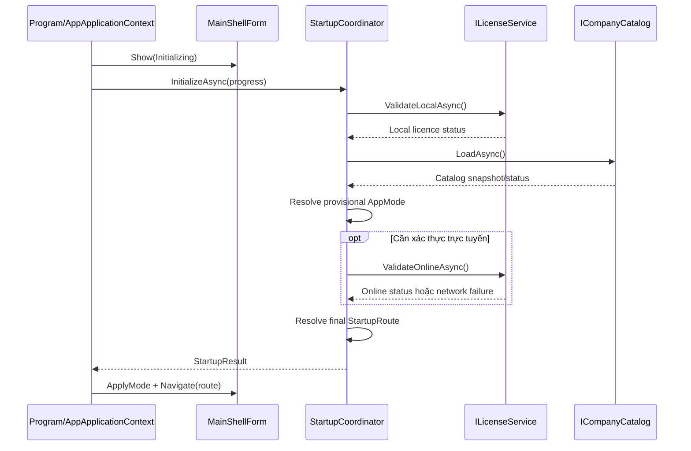
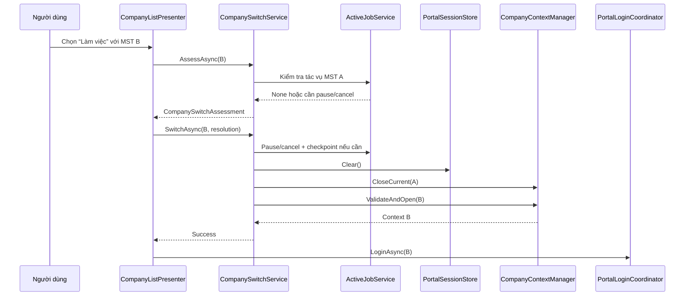
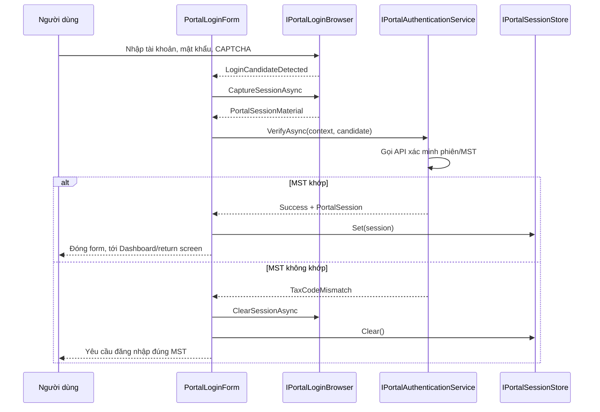

# Detail Design — Khung chương trình, lựa chọn doanh nghiệp và đăng nhập cổng Thuế

## 1. Thông tin tài liệu

| Thuộc tính | Giá trị |
|---|---|
| Mã tài liệu | DD-HDDT-APP-SHELL-LOGIN-001 |
| Phiên bản | 1.0 |
| Ngày | 01/11/2026 |
| Trạng thái | Thiết kế đã được phê duyệt, chờ review tài liệu |
| Nền tảng | Windows Forms, C#, .NET Framework 4.5 |
| Phạm vi | Khung ứng dụng, xác định chế độ licence, lựa chọn MST và đăng nhập cổng Thuế |
| SRS tham chiếu | [SRS-HDDT-001 v1.1](../requirements/SRS.md) |

## 2. Mục đích

Tài liệu này mô tả thiết kế kỹ thuật đủ chi tiết để lập trình viên có thể dựng đúng khung ứng dụng và luồng đăng nhập mà không phải tự suy đoán nghiệp vụ.

Thiết kế giải quyết các câu hỏi chính:

- Chương trình khởi động và xác định StandardMode, ServiceMode hoặc ReadOnlyServiceMode như thế nào.
- Form chính, điều hướng và các màn hình được tổ chức ra sao.
- “Công ty dịch vụ” có đăng nhập riêng hay không.
- Một MST được chọn, mở kho và đăng nhập cổng Thuế như thế nào.
- WebView, token và API client được cách ly khỏi UI ra sao.
- Làm thế nào bảo đảm không trộn session hoặc dữ liệu giữa hai MST.
- Thành phần nào được phép phụ thuộc thành phần nào.
- Những test nào bắt buộc trước khi coi khung chương trình hoàn tất.

## 3. Quyết định nghiệp vụ đã chốt

1. Ứng dụng chỉ có một executable và hai chế độ sử dụng chính.
2. StandardMode quản lý một MST và không hiển thị chức năng đa doanh nghiệp.
3. ServiceMode được mở bằng licence theo máy, không giới hạn số MST đã khai báo.
4. Chỉ một MST hoạt động tại một thời điểm.
5. Mỗi MST có thư mục và SQLite riêng.
6. Công ty dịch vụ không có tài khoản ứng dụng riêng.
7. Đăng nhập cổng Thuế luôn là đăng nhập của MST đang hoạt động.
8. Luồng khởi động được xác định tự động từ licence:
   - StandardMode mở doanh nghiệp duy nhất và yêu cầu đăng nhập cổng Thuế.
   - ServiceMode luôn mở danh sách doanh nghiệp để người dùng chọn MST.
   - ReadOnlyServiceMode mở danh sách doanh nghiệp nhưng không cho đăng nhập hoặc tải mới.
9. WebView chỉ phục vụ đăng nhập thủ công và CAPTCHA; truy xuất nghiệp vụ dùng API client trực tiếp.
10. Token chỉ tồn tại trong bộ nhớ.

Quyết định số 8 thay thế hành vi cũ “ServiceMode mở lại MST gần nhất”.

## 4. Phạm vi

### 4.1 Trong phạm vi

- Tạo solution và các project nền tảng.
- `Program.Main` và composition root.
- `AppApplicationContext`.
- `MainShellForm` và điều hướng màn hình.
- Khởi tạo và xác định chế độ từ licence.
- Khai báo doanh nghiệp StandardMode lần đầu.
- Danh sách, thêm và chọn doanh nghiệp trong ServiceMode.
- Chuyển `CompanyContext` an toàn.
- `PortalLoginForm` chứa WebView.
- Thu candidate token/cookie qua abstraction.
- Xác minh session và MST.
- Quản lý `PortalSession` trong bộ nhớ.
- Hành vi ReadOnlyServiceMode liên quan tới shell/login.
- Xử lý lỗi, logging và test cho các thành phần trên.

### 4.2 Ngoài phạm vi

- Endpoint/payload production của cổng Thuế chưa được xác minh.
- Chọn implementation WebView production trước technical spike.
- Tải, chuẩn hóa, lưu và xuất hóa đơn.
- Tạo PDF và trình xem XML.
- Máy chủ licence production và giao diện quản trị licence.
- Đồng bộ hoặc xử lý song song nhiều MST.
- Tài khoản/role nội bộ của công ty dịch vụ.

## 5. Ràng buộc kỹ thuật

- Target framework: `.NET Framework 4.5` (`net45`).
- Không dùng `async Main`.
- Không dùng API chỉ có trong .NET/.NET Framework mới hơn.
- Bật TLS 1.2 trước mọi kết nối HTTPS.
- Không bỏ qua kiểm tra chứng thư TLS.
- WebView phải được chọn bằng technical spike và ADR.
- Không giả định endpoint, header, payload, cookie hoặc cách lấy token khi chưa xác minh từ cổng thật.
- Build cần Visual Studio/MSBuild và .NET Framework 4.5 targeting pack.
- Mọi logic chia lớp phải có thể unit test mà không khởi động WinForms.

## 6. Kiến trúc solution

### 6.1 Cấu trúc project

```text
src/
├── HoaDonDienTu.sln
├── HoaDonDienTu.Domain/
│   ├── Companies/
│   ├── Licensing/
│   ├── Authentication/
│   └── Common/
├── HoaDonDienTu.Application/
│   ├── Abstractions/
│   ├── Startup/
│   ├── Companies/
│   ├── Licensing/
│   ├── Authentication/
│   └── Navigation/
├── HoaDonDienTu.Infrastructure/
│   ├── Licensing/
│   ├── Companies/
│   ├── Persistence/
│   ├── Portal/
│   ├── WebView/
│   └── Logging/
└── HoaDonDienTu.WinForms/
    ├── Program.cs
    ├── Bootstrap/
    ├── Shell/
    ├── Startup/
    ├── Login/
    ├── Companies/
    ├── Navigation/
    ├── Common/
    └── Resources/

tests/
├── HoaDonDienTu.Domain.Tests/
├── HoaDonDienTu.Application.Tests/
└── HoaDonDienTu.Infrastructure.Tests/
```

### 6.2 Trách nhiệm

| Project | Trách nhiệm | Không được chứa |
|---|---|---|
| Domain | Value object, enum, state, quy tắc thuần nghiệp vụ | WinForms, HTTP, JSON, SQLite, WebView |
| Application | Use case, interface/port, điều phối luồng | Control WinForms, API WebView cụ thể |
| Infrastructure | HTTP, JSON, SQLite, DPAPI, WebView adapter, logging | Quyết định hiển thị UI |
| WinForms | Form, UserControl, presenter, binding và composition root | SQL, HTTP nghiệp vụ, token persistence |

### 6.3 Chiều phụ thuộc

```text
HoaDonDienTu.WinForms ───────> HoaDonDienTu.Application ───────> HoaDonDienTu.Domain
          │                              ▲
          └────> HoaDonDienTu.Infrastructure ──────────────────┘
```

`Application` khai báo interface; `Infrastructure` triển khai. `WinForms` chỉ biết implementation cụ thể tại composition root.

### 6.4 Composition root

Không dùng service locator hoặc tạo service rải rác trong event handler. `CompositionRoot` là nơi duy nhất ghép implementation production/development:

```csharp
public sealed class CompositionRoot : IDisposable
{
    public IStartupCoordinator StartupCoordinator { get; private set; }
    public INavigationService NavigationService { get; private set; }
    public IPortalLoginCoordinator PortalLoginCoordinator { get; private set; }
    public ICompanySwitchService CompanySwitchService { get; private set; }
    public IEntitlementService EntitlementService { get; private set; }

    public MainShellForm CreateMainShell();
    public void Dispose();
}
```

Release build không được đăng ký development adapter.

## 7. Điểm khởi động và vòng đời ứng dụng

### 7.1 `Program.Main`

```csharp
[STAThread]
private static void Main()
{
    ServicePointManager.SecurityProtocol = SecurityProtocolType.Tls12;

    Application.EnableVisualStyles();
    Application.SetCompatibleTextRenderingDefault(false);

    using (var compositionRoot = CompositionRoot.Create())
    using (var applicationContext = new AppApplicationContext(compositionRoot))
    {
        GlobalExceptionHandler.Register(compositionRoot.Logger);
        Application.Run(applicationContext);
    }
}
```

Không thực hiện thao tác mạng dài trước `Application.Run`.

### 7.2 `AppApplicationContext`

`AppApplicationContext` sở hữu vòng đời `MainShellForm` và các form modal:

```csharp
public sealed class AppApplicationContext : ApplicationContext
{
    private readonly CompositionRoot _compositionRoot;
    private readonly MainShellForm _mainShell;

    public AppApplicationContext(CompositionRoot compositionRoot);
    private async void OnMainShellShown(object sender, EventArgs e);
    private void OnMainShellClosed(object sender, FormClosedEventArgs e);
}
```

Trình tự:

1. Tạo `MainShellForm` ở trạng thái `Initializing`.
2. Hiển thị form để Windows message loop hoạt động.
3. Bắt đầu `StartupCoordinator.InitializeAsync` trong sự kiện `Shown`.
4. Render progress vào `InitializingControl`.
5. Nhận `StartupResult` và điều hướng.
6. Khi shell đóng, xóa session, đóng context, flush log và gọi `ExitThread`.

`async void` chỉ được dùng ở UI event boundary và phải bao toàn bộ body bằng handling chuẩn của `IUiOperationRunner` hoặc try/catch chuyển lỗi.

## 8. Xác định chế độ và route khởi động

### 8.1 Kiểu dữ liệu

```csharp
public enum AppMode
{
    Standard,
    Service,
    ReadOnlyService
}

public enum StartupRoute
{
    StandardFirstRun,
    StandardPortalLogin,
    ServiceCompanySelection,
    ReadOnlyCompanySelection,
    Recovery
}
```

```csharp
public sealed class StartupResult
{
    public AppMode Mode { get; private set; }
    public StartupRoute Route { get; private set; }
    public LicenseStatus LicenseStatus { get; private set; }
    public CompanyProfile StandardCompany { get; private set; }
    public string UserMessage { get; private set; }
    public RecoveryReason RecoveryReason { get; private set; }
}
```

### 8.2 Interface

```csharp
public interface IStartupCoordinator
{
    Task<StartupResult> InitializeAsync(
        IProgress<StartupProgress> progress,
        CancellationToken cancellationToken);
}
```

Dependency:

- `ILocalSettingsStore`.
- `ILicenseService`.
- `ICompanyCatalog`.
- `ICompanyContextManager`.
- `IClock`.
- `IApplicationLogger`.

### 8.3 State machine

```text
Created
  → LoadingLocalSettings
  → ValidatingLocalLicence
  → LoadingCompanyCatalog
  → ResolvingMode
  → ValidatingLicenceOnline
  → Ready
  └→ RecoveryRequired
```

### 8.4 Bảng quyết định

| Điều kiện | AppMode | StartupRoute |
|---|---|---|
| Không licence, chưa có doanh nghiệp | Standard | StandardFirstRun |
| Không licence, có một doanh nghiệp | Standard | StandardPortalLogin |
| Licence dịch vụ hợp lệ | Service | ServiceCompanySelection |
| Không kết nối licence server nhưng còn grace period | Service | ServiceCompanySelection, kèm cảnh báo |
| Licence hết hạn/thu hồi/quá grace và từng có dữ liệu dịch vụ | ReadOnlyService | ReadOnlyCompanySelection |
| Catalog/kho không thể xác minh | Không tự suy đoán | Recovery |

ServiceMode không tự mở MST gần nhất.

### 8.5 Thuật toán

```text
1. Đọc local settings.
2. Nếu có license.dat:
   2.1. Giải mã DPAPI.
   2.2. Xác minh chữ ký.
   2.3. Xác minh machine binding và thời gian.
3. Đọc companies.json nếu tồn tại.
4. Xác minh cấu trúc catalog, không mở toàn bộ SQLite.
5. Xác định có từng chạy ServiceMode hay không.
6. Tính AppMode cục bộ.
7. Nếu cần và có mạng, xác thực licence trực tuyến.
8. Tính StartupRoute cuối.
9. Không ghi file nếu chỉ đang đọc/xác định route.
```

Nếu licence hỏng nhưng có nhiều kho, không được rơi về StandardMode rồi che mất dữ liệu.

### 8.6 Sequence khởi động



## 9. `MainShellForm`

### 9.1 Mục tiêu

`MainShellForm` là cửa sổ chính duy nhất, giữ bố cục chung và vùng nội dung. Không dùng MDI.

### 9.2 Cây control

```text
MainShellForm
├── pnlSidebar
│   ├── lblApplicationName
│   ├── navDashboard
│   ├── navDownload
│   ├── navInvoiceArchive
│   ├── navDownloadHistory
│   ├── navCompanies
│   └── navSettings
├── pnlHeader
│   ├── btnCompanyContext
│   ├── lblCompanyName
│   ├── lblTaxCode
│   ├── lblLicenseStatus
│   ├── lblPortalSession
│   └── btnPortalLogin
├── pnlContent
│   └── ActiveScreenControl
└── statusStrip
    ├── lblOperationStatus
    ├── progressOperation
    └── lblApplicationVersion
```

### 9.3 Trạng thái theo chế độ

| Thành phần | Standard | Service | ReadOnlyService |
|---|---:|---:|---:|
| Bộ chọn doanh nghiệp | Ẩn | Hiện | Hiện |
| Menu doanh nghiệp | Ẩn | Hiện | Hiện |
| Đăng nhập Thuế | Cho phép | Cho phép sau khi chọn MST | Khóa |
| Tải mới | Cho phép sau đăng nhập | Cho phép sau đăng nhập | Khóa |
| Xem/in/xuất dữ liệu cũ | Cho phép | Cho phép | Cho phép |
| Thêm MST | Ẩn | Cho phép | Khóa |
| Nhãn licence | Nhãn tĩnh/ẩn | Bản dịch vụ | Chỉ đọc – cần gia hạn |

### 9.4 View contract

```csharp
public interface IMainShellView
{
    event EventHandler<NavigationRequestedEventArgs> NavigationRequested;
    event EventHandler CompanySelectorRequested;
    event EventHandler PortalLoginRequested;
    event EventHandler ShellClosingRequested;

    void ApplyMode(ShellModeViewState state);
    void ShowCompany(CompanyHeaderViewState state);
    void ShowPortalSession(PortalSessionViewState state);
    void ShowOperation(OperationViewState state);
    void ShowScreen(Control screen);
    void ShowError(UserFacingError error);
}
```

### 9.5 Presenter

```csharp
public sealed class MainShellPresenter : IDisposable
{
    private readonly IMainShellView _view;
    private readonly INavigationService _navigation;
    private readonly ICompanyContextAccessor _companyContext;
    private readonly IEntitlementService _entitlement;
    private readonly IPortalSessionAccessor _portalSession;

    public void Initialize();
    public void Dispose();
}
```

Presenter đăng ký event tại `Initialize` và hủy đăng ký tại `Dispose`.

### 9.6 Điều hướng

```csharp
public enum ScreenId
{
    Initializing,
    Dashboard,
    Download,
    DownloadProgress,
    InvoiceArchive,
    InvoiceDetail,
    InvoiceViewer,
    DownloadHistory,
    Settings,
    CompanyList,
    CompanyEdit,
    License,
    Recovery
}
```

```csharp
public interface INavigationService
{
    ScreenId CurrentScreen { get; }
    bool CanNavigate(ScreenId target);

    Task<NavigationResult> NavigateAsync(
        ScreenId target,
        object parameter,
        CancellationToken cancellationToken);
}
```

`IScreenFactory` tạo UserControl + presenter. Không `new` screen trong click handler.

### 9.7 Đóng màn hình

Trước khi thay control trong `pnlContent`:

1. Gọi `CanCloseAsync` nếu screen có state chưa hoàn tất.
2. Hủy operation riêng của screen.
3. Dispose presenter và event subscription.
4. Remove/dispose control.
5. Tạo screen mới.

## 10. Khai báo doanh nghiệp StandardMode lần đầu

### 10.1 Giao diện

`CompanySetupControl` hiển thị trong `MainShellForm`; menu nghiệp vụ bị ẩn.

Trường bắt buộc:

- MST.
- Tên hiển thị.
- Thư mục kho.

### 10.2 Quy trình

```text
Nhập dữ liệu
  → chuẩn hóa MST
  → kiểm tra thư mục/quyền ghi
  → kiểm tra database hiện hữu
  → tạo cấu trúc/database tạm
  → xác minh schema/MST
  → commit cấu hình
  → tạo CompanyContext
  → mở PortalLoginForm
```

Nếu commit thất bại, không đánh dấu hồ sơ hoàn tất và không ghi đè dữ liệu đã tồn tại.

## 11. Danh sách doanh nghiệp ServiceMode

### 11.1 `CompanyListControl`

Danh sách chỉ đọc `companies.json` và cache tổng quan:

```csharp
public sealed class CompanyCatalogItem
{
    public CompanyId Id { get; private set; }
    public TaxCode TaxCode { get; private set; }
    public string DisplayName { get; private set; }
    public string StoragePath { get; private set; }
    public DateTime? LastOpenedAt { get; private set; }
    public DateTime? LastDownloadedAt { get; private set; }
    public long CachedInvoiceCount { get; private set; }
    public long CachedStorageBytes { get; private set; }
    public CompanyCatalogStatus Status { get; private set; }
}
```

Không mở SQLite của nhiều MST để dựng danh sách.

### 11.2 Chọn MST

```text
Chọn “Làm việc”
  → kiểm tra entitlement
  → đánh giá tác vụ của context hiện tại
  → chờ/pause/cancel theo lựa chọn người dùng
  → xóa PortalSession
  → đóng SQLite/file handle cũ
  → xác minh kho mới
  → mở CompanyContext mới
  → cập nhật header
  → mở PortalLoginForm
```

Trong ReadOnlyServiceMode, bước cuối là Dashboard/Kho hóa đơn; không mở form đăng nhập.

## 12. `CompanyContext` và chuyển MST

### 12.1 Context

```csharp
public sealed class CompanyContext : IDisposable
{
    public CompanyId CompanyId { get; private set; }
    public TaxCode TaxCode { get; private set; }
    public string DisplayName { get; private set; }
    public string StorageRoot { get; private set; }
    public ICompanyUnitOfWorkFactory UnitOfWorkFactory { get; private set; }
}
```

```csharp
public interface ICompanyContextAccessor
{
    bool HasCurrent { get; }
    CompanyContext Current { get; }
}
```

Chỉ `ICompanyContextManager` được thay đổi current context.

### 12.2 Switch service

```csharp
public interface ICompanySwitchService
{
    Task<CompanySwitchAssessment> AssessAsync(
        CompanyId targetCompanyId,
        CancellationToken cancellationToken);

    Task<CompanySwitchResult> SwitchAsync(
        CompanyId targetCompanyId,
        ActiveJobResolution jobResolution,
        CancellationToken cancellationToken);
}
```

```csharp
public enum CompanySwitchBlocker
{
    None,
    DownloadRunning,
    StorageUnavailable,
    DatabaseLocked,
    DatabaseInvalid,
    LicenceReadOnly
}

public enum ActiveJobResolution
{
    NotRequired,
    WaitForCompletion,
    PauseAndSwitch,
    CancelAndSwitch
}
```

### 12.3 Thứ tự bắt buộc

1. Giữ async gate để chỉ một switch chạy.
2. Đánh giá active job.
3. Pause/cancel và ghi checkpoint nếu được yêu cầu.
4. Xóa portal API client/session.
5. Dispose context hiện tại.
6. Xác minh target storage.
7. Mở target context.
8. Chỉ sau khi thành công mới cập nhật active company/cache.
9. Phát sự kiện context changed.

Nếu mở target thất bại, thử phục hồi context trước. Nếu cả hai thất bại, điều hướng Recovery.



### 12.4 Storage guard

Trước mọi thao tác ghi:

```text
Command.CompanyId == CompanyContext.CompanyId
Command.TaxCode == CompanyContext.TaxCode
PortalSession.TaxCode == CompanyContext.TaxCode (nếu cần portal)
Repository storage root thuộc CompanyContext.StorageRoot
Entitlement cho phép thao tác
```

Không khớp bất kỳ điều kiện nào phải từ chối trước khi ghi.

## 13. Thêm/sửa doanh nghiệp ServiceMode

`CompanyEditControl` ghi theo hai pha:

```text
Pha 1
  → validate input
  → chuẩn bị thư mục/database tạm
  → xác minh schema/MST/quyền

Pha 2
  → ghi companies.json.tmp
  → đọc và xác minh lại
  → replace atomic companies.json
  → đổi tài nguyên tạm thành chính thức
```

MST đã có dữ liệu không được sửa. Muốn quản lý MST khác phải tạo hồ sơ/kho khác.

“Ngừng quản lý” chỉ bỏ liên kết catalog, không xóa thư mục.

## 14. `PortalLoginForm`

### 14.1 Ý nghĩa

Chỉ có một loại form đăng nhập. Form luôn đăng nhập MST đang hoạt động trên cổng Thuế.

Không tồn tại:

- `ServiceLoginForm`.
- Username/password riêng cho công ty dịch vụ.
- Đăng nhập đồng thời nhiều MST.

### 14.2 Request

```csharp
public sealed class PortalLoginRequest
{
    public CompanyId CompanyId { get; private set; }
    public TaxCode ExpectedTaxCode { get; private set; }
    public LoginReason Reason { get; private set; }
    public ScreenId ReturnScreen { get; private set; }
    public object ReturnParameter { get; private set; }
}
```

Form không được mở nếu:

- Chưa có context.
- Entitlement chỉ đọc.
- MST hồ sơ không hợp lệ.
- Context đang chuyển/đóng.
- Đã có form login khác hoạt động.

### 14.3 Cây control

```text
PortalLoginForm
├── pnlHeader
│   ├── lblTitle
│   ├── lblCompanyName
│   ├── lblExpectedTaxCode
│   └── lblSecurityNotice
├── pnlInstruction
│   ├── lblStep
│   ├── lblStateMessage
│   ├── progressLogin
│   ├── pnlError
│   └── btnRetry
├── pnlBrowserHost
│   └── IPortalLoginBrowser.View
└── pnlActions
    ├── btnClearSession
    └── btnCancel
```

Tên doanh nghiệp và MST dự kiến phải luôn hiển thị.

### 14.4 State machine

```text
Created
  → InitializingBrowser
  → ClearingPreviousSession
  → LoadingPortalLogin
  → WaitingForUser
  → AuthenticationCandidateDetected
  → VerifyingPortalSession
  → VerifyingTaxCode
  → Succeeded
```

Nhánh lỗi:

```text
InitializingBrowser → BrowserUnavailable
LoadingPortalLogin  → PortalUnavailable
VerifyingSession    → InvalidSession
VerifyingTaxCode    → TaxCodeMismatch
Any active state    → Cancelled
```

### 14.5 WebView abstraction

```csharp
public interface IPortalLoginBrowser : IDisposable
{
    Control View { get; }

    event EventHandler<LoginCandidateEventArgs> LoginCandidateDetected;
    event EventHandler<BrowserNavigationEventArgs> NavigationChanged;
    event EventHandler<BrowserFailureEventArgs> BrowserFailed;

    Task InitializeAsync(CancellationToken cancellationToken);
    Task ClearSessionAsync(CancellationToken cancellationToken);
    Task NavigateToLoginAsync(CancellationToken cancellationToken);
    Task<PortalSessionMaterial> CaptureSessionAsync(
        CancellationToken cancellationToken);
}
```

Interface không giả định token nằm trong cookie, header hay storage.

### 14.6 Quy trình xác minh



Điều hướng khỏi trang login không đủ để xác nhận thành công.

### 14.7 Authentication service

```csharp
public interface IPortalAuthenticationService
{
    Task<PortalLoginResult> VerifyAsync(
        CompanyContext company,
        PortalSessionMaterial candidate,
        CancellationToken cancellationToken);
}
```

```csharp
public enum PortalLoginOutcome
{
    Success,
    Cancelled,
    InvalidSession,
    TaxCodeMismatch,
    PortalUnavailable,
    BrowserUnavailable
}
```

### 14.8 Coordinator

```csharp
public interface IPortalLoginCoordinator
{
    Task<PortalLoginResult> LoginAsync(
        PortalLoginRequest request,
        IWin32Window owner,
        CancellationToken cancellationToken);
}
```

Coordinator dùng gate để không mở hai form cùng lúc.

Kết quả thành công:

- Khởi động StandardMode → Dashboard.
- Chọn MST ServiceMode → Dashboard của MST đó.
- Token hết hạn giữa phiên tải → quay lại screen/checkpoint trong request.
- Cancel → quay lại screen trước và không giữ candidate token.

## 15. Quản lý portal session và API client

### 15.1 Session store

```csharp
public interface IPortalSessionStore
{
    bool HasActiveSession { get; }
    PortalSessionSnapshot GetSnapshot();
    void Set(PortalSession session);
    void Clear();
}
```

- Chỉ một session trong bộ nhớ.
- Snapshot cho UI không chứa token.
- Không serialize session/token.
- Clear khi đổi MST, logout, token hết hạn hoặc đóng app.

### 15.2 API client generation

Một portal API client dùng cho một generation của session:

```text
Session generation N hợp lệ
  → tạo PortalApiClient N
  → reuse cho request của MST hiện tại
  → clear/switch/expiry
  → dispose client + handler N
```

Không tạo `HttpClient` cho từng request. Không dùng chung portal handler với licence client.

```csharp
public interface IPortalApiClientFactory
{
    IPortalApiClient Create(
        CompanyContext company,
        PortalSession session);
}
```

## 16. MVP và cấu trúc file WinForms

### 16.1 File

```text
HoaDonDienTu.WinForms/
├── Program.cs
├── Bootstrap/
│   ├── AppApplicationContext.cs
│   ├── CompositionRoot.cs
│   └── GlobalExceptionHandler.cs
├── Shell/
│   ├── MainShellForm.cs
│   ├── MainShellForm.Designer.cs
│   ├── MainShellPresenter.cs
│   ├── IMainShellView.cs
│   ├── ScreenHost.cs
│   └── ShellModeViewState.cs
├── Startup/
│   ├── InitializingControl.cs
│   ├── InitializingPresenter.cs
│   └── RecoveryControl.cs
├── Login/
│   ├── PortalLoginForm.cs
│   ├── PortalLoginForm.Designer.cs
│   ├── PortalLoginPresenter.cs
│   ├── IPortalLoginView.cs
│   └── PortalLoginCoordinator.cs
├── Companies/
│   ├── CompanySetupControl.cs
│   ├── CompanySetupPresenter.cs
│   ├── CompanyListControl.cs
│   ├── CompanyListPresenter.cs
│   ├── CompanyEditControl.cs
│   └── CompanyEditPresenter.cs
├── Navigation/
│   ├── NavigationService.cs
│   ├── ScreenFactory.cs
│   └── ScreenDescriptor.cs
└── Common/
    ├── UiOperationRunner.cs
    ├── UserErrorPresenter.cs
    └── ConfirmationService.cs
```

### 16.2 Presenter rules

Presenter:

- Constructor injection.
- Subscribe event tại `Initialize`.
- Unsubscribe tại `Dispose`.
- Không tham chiếu `TextBox`, `Panel`, `DataGridView` cụ thể.
- Không gọi `MessageBox` trực tiếp.
- Không giữ token, connection hoặc WebView.
- Không tự marshal thread.

View:

- Đọc input và phát event.
- Render view state.
- Không gọi HTTP/SQLite/file nghiệp vụ.
- Không tạo service.
- Không nuốt exception.

### 16.3 UI operation runner

```csharp
public interface IUiOperationRunner
{
    Task RunAsync(
        string operationName,
        Func<CancellationToken, Task> operation,
        Action<UiOperationState> renderState);
}
```

Trách nhiệm:

- Chặn double click/re-entry.
- Sở hữu `CancellationTokenSource`.
- Render busy/progress.
- Gán correlation ID.
- Map exception sang `UserFacingError`.
- Luôn phục hồi UI trong `finally`.

### 16.4 File chính của Application

```text
HoaDonDienTu.Application/
├── Startup/
│   ├── IStartupCoordinator.cs
│   ├── StartupCoordinator.cs
│   ├── StartupResult.cs
│   └── StartupProgress.cs
├── Licensing/
│   ├── ILicenseService.cs
│   ├── IEntitlementService.cs
│   └── LicenseStatus.cs
├── Companies/
│   ├── ICompanyCatalog.cs
│   ├── ICompanyContextAccessor.cs
│   ├── ICompanyContextManager.cs
│   ├── ICompanySwitchService.cs
│   ├── CompanySwitchService.cs
│   └── CompanyContext.cs
├── Authentication/
│   ├── IPortalAuthenticationService.cs
│   ├── IPortalSessionStore.cs
│   ├── IPortalApiClientFactory.cs
│   └── PortalLoginResult.cs
└── Common/
    ├── OperationResult.cs
    ├── UserFacingError.cs
    └── IApplicationLogger.cs
```

### 16.5 File chính của Infrastructure

```text
HoaDonDienTu.Infrastructure/
├── Licensing/
│   ├── LicenseService.cs
│   ├── LicenseApiClient.cs
│   ├── LicenseSignatureVerifier.cs
│   └── MachineIdentityProvider.cs
├── Companies/
│   ├── JsonCompanyCatalog.cs
│   ├── AtomicJsonWriter.cs
│   └── CompanyStorageValidator.cs
├── Persistence/
│   ├── SqliteCompanyContextFactory.cs
│   ├── CompanyDatabaseInitializer.cs
│   └── SchemaVersionReader.cs
├── Portal/
│   ├── PortalApiClient.cs
│   ├── PortalAuthenticationService.cs
│   └── InMemoryPortalSessionStore.cs
└── WebView/
    ├── IPortalLoginBrowser.cs
    └── Adapter production được chọn sau ADR
```

## 17. Threading và bất đồng bộ

- Service I/O trả `Task`/`Task<T>`.
- Chỉ UI event handler được `async void`.
- Mọi task nghiệp vụ phải được await.
- Tác vụ dài nhận `CancellationToken`.
- Không truy cập WinForms control từ background thread.
- Dùng captured UI context hoặc `Control.BeginInvoke` khi cần.
- Không dùng `Task.Run` để bọc API I/O đã async.
- Chỉ dùng background task cho CPU/file API đồng bộ và phải có progress/cancellation.
- Khi dispose screen/form, cancel operation rồi chờ cleanup hợp lý trước khi giải phóng dependency.

## 18. Licence

### 18.1 Local entitlement

- `license.dat` được DPAPI `LocalMachine` bảo vệ.
- File vẫn phải có chữ ký bất đối xứng của server.
- Public key xác minh được nhúng trong application.
- DPAPI không thay thế chữ ký.
- Thư mục áp dụng ACL phù hợp.
- Thời gian sử dụng ngoại tuyến tối đa là 30 ngày kể từ lần xác thực trực tuyến thành công gần nhất.

### 18.2 Dữ liệu gửi server

Chỉ gửi:

- Licence key.
- Mã máy đã băm.
- Phiên bản ứng dụng.

Không gửi:

- MST.
- Số lượng/danh sách khách hàng.
- Token Thuế.
- Hóa đơn.
- Đường dẫn kho.

### 18.3 ReadOnlyServiceMode

Được phép:

- Mở các MST đã có.
- Xem, tìm, in, xuất và sao lưu dữ liệu cũ.

Không được phép:

- Thêm MST.
- Đăng nhập cổng Thuế.
- Tải mới.
- Sửa cấu hình nghiệp vụ quan trọng.

Kiểm soát ở cả UI và application service.

## 19. WebView technical gate

Detail Design không chọn WebView cụ thể. Trước implementation production phải:

1. Thử WebBrowser/CefSharp hoặc lựa chọn phù hợp khác trên máy đích.
2. Xác nhận tương thích .NET Framework 4.5.
3. Render được cổng Thuế thật.
4. Nhập CAPTCHA thủ công được.
5. Phát hiện và lấy được session hợp lệ.
6. Xóa session giữa hai MST.
7. Chặn/kiểm soát điều hướng ngoài domain.
8. Ghi quyết định tại `docs/decisions/`.

Không đưa API WebView cụ thể ra ngoài Infrastructure adapter.

## 20. Bảo mật

### 20.1 TLS

- Bật TLS 1.2.
- Không callback chấp nhận mọi chứng thư.
- Không hạ TLS để xử lý lỗi.

### 20.2 Dữ liệu xác thực

Không được:

- Đọc/tự điền password.
- Giải CAPTCHA.
- Ghi token/cookie/password/CAPTCHA vào log.
- Lưu token trong SQLite/JSON/settings.
- Đưa token vào view state.

### 20.3 Log

Được phép:

- Timestamp.
- Event code.
- Correlation ID.
- CompanyId nội bộ.
- MST đã che.
- Operation/status.
- HTTP status đã làm sạch.

Không được phép:

- Secret/token/cookie.
- Licence key đầy đủ.
- XML/request/response body thật.
- Dữ liệu cá nhân không cần thiết.

## 21. Xử lý lỗi

### 21.1 Taxonomy

```csharp
public enum ErrorCategory
{
    Validation,
    Configuration,
    Licence,
    Storage,
    Database,
    Browser,
    PortalAuthentication,
    PortalApi,
    Network,
    Cancelled,
    Unexpected
}
```

```csharp
public sealed class UserFacingError
{
    public string Code { get; private set; }
    public ErrorCategory Category { get; private set; }
    public string Title { get; private set; }
    public string Message { get; private set; }
    public string SuggestedAction { get; private set; }
    public string CorrelationId { get; private set; }
    public bool CanRetry { get; private set; }
}
```

Thông báo phải nêu thao tác, doanh nghiệp bị ảnh hưởng, dữ liệu đã giữ hay chưa, hành động tiếp theo và correlation ID.

### 21.2 Global handler

Đăng ký:

- `Application.ThreadException`.
- `AppDomain.CurrentDomain.UnhandledException`.
- `TaskScheduler.UnobservedTaskException`.

Global handler không được dùng để che lỗi rồi tiếp tục trong trạng thái không xác định.

### 21.3 Recovery rules

- Không tạo database rỗng thay file lỗi/mất.
- Không ghi đè `companies.json` lỗi.
- Không mở login khi context chưa hợp lệ.
- Lỗi server licence không đồng nghĩa bị thu hồi.
- Nếu đổi context thất bại, phục hồi context trước hoặc vào Recovery.

## 22. Ghi file atomic

Áp dụng cho `companies.json`, licence cache và cấu hình:

```text
ghi <file>.tmp cùng volume
  → flush
  → đọc/xác minh lại
  → replace/rename atomic
  → giữ <file>.bak gần nhất khi phù hợp
```

Không ghi đè trực tiếp file đang dùng.

## 23. Đóng ứng dụng

### 23.1 Không có tác vụ ghi

```text
FormClosing
  → clear portal session/client
  → dispose CompanyContext
  → flush log
  → ExitThread
```

### 23.2 Có tác vụ ghi

```text
FormClosing
  → cancel đóng tạm thời
  → hỏi Chờ / Tạm dừng và thoát / Hủy tác vụ
  → ghi checkpoint
  → đóng session/context
  → đóng form
```

Không dùng `Environment.Exit` cho luồng thường.

## 24. Kiểm thử

### 24.1 StartupCoordinator

- Không licence + chưa có doanh nghiệp → StandardFirstRun.
- Không licence + một doanh nghiệp → StandardPortalLogin.
- Licence hợp lệ → ServiceCompanySelection.
- Licence offline còn hạn → Service + cảnh báo.
- Licence mất hiệu lực + nhiều kho → ReadOnlyCompanySelection.
- Catalog lỗi → Recovery, không tạo file mới.
- Cancellation không để migration dở dang.

### 24.2 MainShellPresenter

- Standard ẩn selector/menu doanh nghiệp.
- Service hiện selector/menu doanh nghiệp.
- ReadOnly khóa login/tải/thêm MST.
- Session thay đổi cập nhật header.
- Navigation bị từ chối khi screen không thể đóng.
- Dispose hủy event subscription.

### 24.3 PortalLoginPresenter

- Không context → không mở browser.
- Browser init → WaitingForUser.
- Candidate đúng MST → Success.
- Candidate sai MST → clear + mismatch.
- Candidate/token lỗi → retry.
- Cancel → clear + return screen.
- Hai login đồng thời → một form.
- View/log không chứa token.

### 24.4 CompanySwitchService

- Chuyển khi không có job.
- Chuyển với pause/cancel.
- Context cũ đóng trước context mới.
- Mở target lỗi → phục hồi context cũ.
- Session clear trước switch.
- Context/MST không khớp → từ chối.
- ReadOnly mở kho nhưng không login.

### 24.5 Integration

- Atomic JSON và `.bak` recovery.
- Hai MST có hai SQLite độc lập.
- Service không giữ hai context.
- DPAPI licence cache.
- Chữ ký licence sai.
- Portal/licence HTTP handler độc lập.
- Session generation cũ bị vô hiệu.
- Database locked/schema sai/path mất.

### 24.6 UI smoke

- Standard khởi động tới login.
- Service khởi động tại danh sách.
- Chọn MST mở login đúng tên/MST.
- Hủy login quay lại đúng screen.
- Bật licence hiện menu mà không cài lại.
- ReadOnly không có action tải.
- Đóng app thực hiện cleanup.

## 25. Development adapter

Được phép trong Debug để dựng/test khung:

- `DevelopmentLicenseService`.
- `DevelopmentPortalLoginBrowser`.
- Fake `IPortalAuthenticationService`.

Yêu cầu:

- Namespace/folder rõ `Development`.
- Không chứa secret thật.
- Không được đăng ký trong Release composition root.
- UI phải hoạt động qua cùng interface với production adapter.
- Không coi endpoint/payload fake là tài liệu API thật.

## 26. Thứ tự triển khai khuyến nghị

1. Tạo solution/project và test project.
2. Tạo Domain value object/enums tối thiểu.
3. Tạo Application interface/result/state.
4. Dựng composition root và `AppApplicationContext`.
5. Dựng `MainShellForm`, screen host và navigation.
6. Dựng `StartupCoordinator` với fake licence/catalog.
7. Dựng Standard first-run company setup.
8. Dựng Service company list/edit/switch.
9. Dựng `PortalLoginForm` qua development browser adapter.
10. Dựng in-memory session và fake verification.
11. Thêm error/logging/cleanup.
12. Hoàn thành unit/integration/UI smoke test.
13. Thực hiện WebView/API technical spike và ADR.
14. Thay development adapter bằng production adapter đã xác minh.

## 27. Definition of Done

- Solution build bằng MSBuild với net45 targeting pack.
- Dependency đúng chiều.
- Không có nghiệp vụ trong `.Designer.cs`.
- Chạy được Standard, Service và ReadOnly bằng development configuration.
- Service luôn mở danh sách doanh nghiệp khi khởi động.
- Chỉ một `CompanyContext`, `PortalSession` và `PortalLoginForm` tồn tại.
- Sai MST không tạo session hoặc ghi dữ liệu.
- Token không xuất hiện trong file/log/view state.
- Test startup, presenter, session và switch pass.
- README/CLAUDE.md có lệnh build/test thực tế sau khi solution được tạo.
- Không có secret hoặc dữ liệu doanh nghiệp thật trong repository.

## 28. Ma trận truy vết

| Thành phần Detail Design | Yêu cầu SRS chính |
|---|---|
| Startup mode/route | BR-001, BR-016, FR-COMP-001, FR-LIC-004..008 |
| MainShellForm | FR-COMP-006, NFR-USE-003, NFR-USE-006..007 |
| Company setup/list | FR-SET-001..003, FR-COMP-002..005 |
| Company switch/context | BR-017..020, FR-COMP-007..012, NFR-REL-006 |
| PortalLoginForm | FR-AUTH-001..012, BR-020 |
| Session/API client | NFR-SEC-001..002, NFR-SEC-006 |
| ReadOnlyServiceMode | BR-022, FR-LIC-007..008 |
| Atomic storage/recovery | NFR-REL-001..003, NFR-REL-007 |
| Test/technical gate | NFR-MNT-001..006, mục 16–17 SRS |

## 29. Điểm chưa được phép tự quyết định khi code

Các mục sau cần bằng chứng technical spike/ADR, không được lập trình viên tự chọn và hard-code:

- WebView engine production.
- Cách phát hiện login thành công.
- Vị trí/định dạng token hoặc cookie.
- Endpoint xác minh phiên/MST.
- Endpoint nghiệp vụ hóa đơn.
- Header/payload/pagination/rate limit cổng Thuế.
- Thuật toán/chính sách licence production ngoài contract đã mô tả.

Khi chưa có quyết định, code chỉ được dừng ở interface và development adapter.
