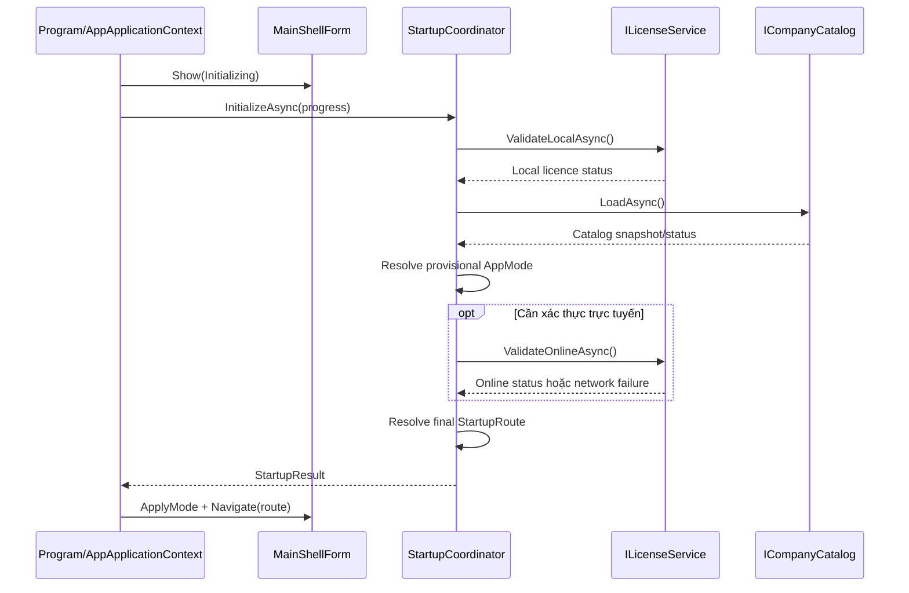
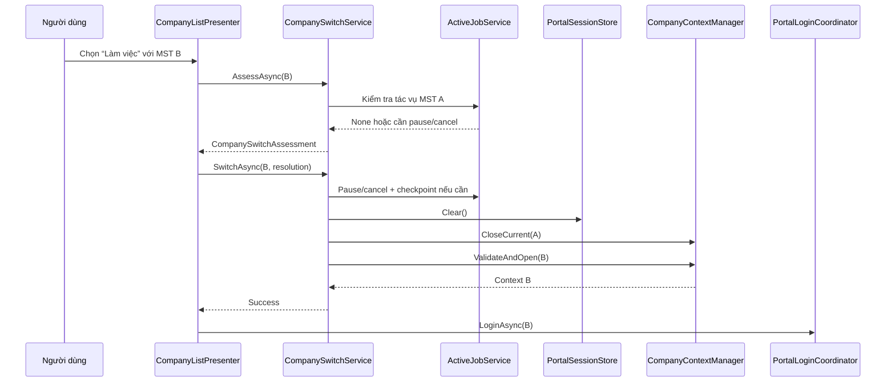
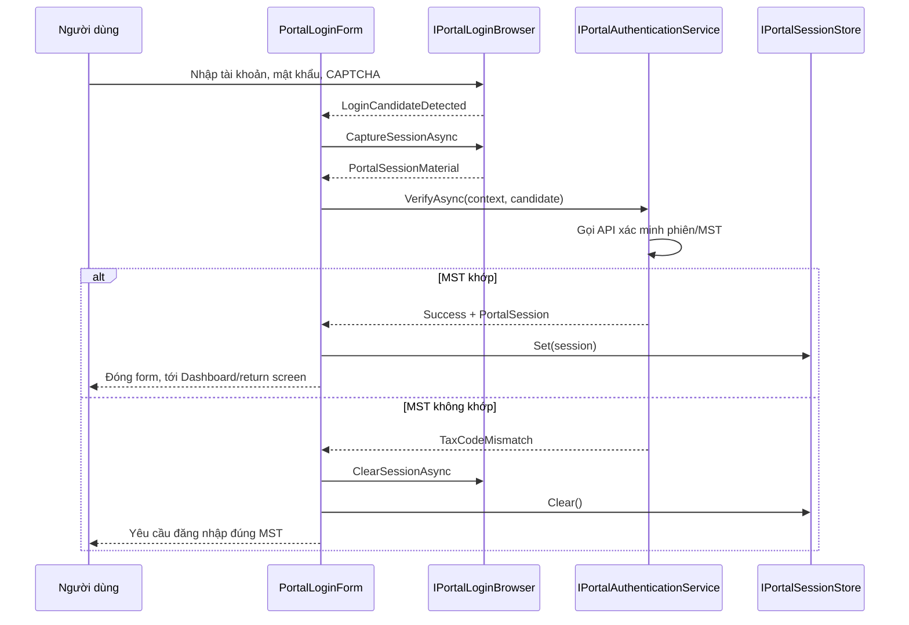

# DD-01 — Khung chương trình, khởi động và đăng nhập cổng Thuế

## 1. Thông tin tài liệu

| Thuộc tính | Giá trị |
|---|---|
| Mã tài liệu | DD-HDDT-01 |
| Tên | Khung chương trình, xác định chế độ, điều hướng và đăng nhập cổng Thuế |
| Phiên bản | 1.1 (chuẩn hóa từ DD-HDDT-APP-SHELL-LOGIN-001 v1.0) |
| Ngày | 01/11/2026 |
| Trạng thái | Thiết kế đã phê duyệt — chờ review tài liệu |
| Feature | [FT-01](../requirements/FEATURE-LIST.md#ft-01--khung-chương-trình-khởi-động-và-điều-hướng) · [FT-02](../requirements/FEATURE-LIST.md#ft-02--đăng-nhập-cổng-thuế-và-quản-lý-phiên) |
| SRS | [SRS-HDDT-001 v1.1](../requirements/SRS.md) |
| Màn hình | SCR-01 (Đăng nhập); khung dùng chung cho SCR-02…SCR-12 |
| Wireframe | [SCR-01](../wireframes/index.html?screen=SCR-01) · [PNG](../wireframes/png/SCR-01-login.png) |
| Phụ thuộc | [DD-00](DD-00-TECHNICAL-GATES.md) (WebView/API), [DD-02](DD-02-COMPANY-MANAGEMENT.md) (danh mục MST), [DD-03](DD-03-LICENSING.md) (entitlement) |
| Phase triển khai | [Phase 2](../plans/PROJECT-PLAN.md#phase-2--khung-chương-trình-doanh-nghiệp-licence-và-đăng-nhập) |
| Nền tảng | Windows Forms, C#, .NET Framework 4.5 |

## 2. Mục đích, phạm vi và quyết định đã chốt

### 2.1 Mục đích

Mô tả thiết kế kỹ thuật đủ chi tiết để lập trình viên dựng đúng khung ứng dụng và luồng đăng nhập mà không phải tự suy đoán nghiệp vụ. Tài liệu trả lời:

- Chương trình khởi động và xác định StandardMode, ServiceMode hoặc ReadOnlyServiceMode như thế nào.
- Form chính, điều hướng và các màn hình được tổ chức ra sao.
- Một MST được chọn, mở kho và đăng nhập cổng Thuế như thế nào; “công ty dịch vụ” có đăng nhập riêng hay không.
- WebView, token và API client được cách ly khỏi UI ra sao; làm sao không trộn session/dữ liệu giữa hai MST.
- Thành phần nào được phép phụ thuộc thành phần nào; test nào bắt buộc trước khi coi khung hoàn tất.

### 2.2 Quyết định nghiệp vụ đã chốt

1. Ứng dụng chỉ có một executable và hai chế độ sử dụng chính.
2. StandardMode quản lý một MST và không hiển thị chức năng đa doanh nghiệp.
3. ServiceMode được mở bằng licence theo máy, không giới hạn số MST đã khai báo.
4. Chỉ một MST hoạt động tại một thời điểm; mỗi MST có thư mục và SQLite riêng.
5. Công ty dịch vụ không có tài khoản ứng dụng riêng; đăng nhập cổng Thuế luôn là của MST đang hoạt động.
6. Luồng khởi động được xác định tự động từ licence:
   - StandardMode mở doanh nghiệp duy nhất và yêu cầu đăng nhập cổng Thuế.
   - ServiceMode luôn mở danh sách doanh nghiệp để người dùng chọn MST (không mở lại MST gần nhất).
   - ReadOnlyServiceMode mở danh sách doanh nghiệp nhưng không cho đăng nhập hoặc tải mới.
7. WebView chỉ phục vụ đăng nhập thủ công và CAPTCHA; truy xuất nghiệp vụ dùng API client trực tiếp.
8. Token chỉ tồn tại trong bộ nhớ.

### 2.3 Trong phạm vi

- Tạo solution và các project nền tảng.
- `Program.Main`, composition root, `AppApplicationContext`.
- `MainShellForm`, điều hướng, screen host.
- Khởi tạo và xác định chế độ từ licence (consume `ILicenseService`/`IEntitlementService` của DD-03).
- `CompanyContext`, `ICompanyContextManager`, `CompanySwitchService` (cơ chế lõi; giao diện danh mục ở DD-02).
- `PortalLoginForm` chứa WebView, thu candidate token/cookie qua abstraction, xác minh session và MST.
- `PortalSession` trong bộ nhớ, API client generation.
- Xử lý lỗi, logging, ghi file atomic, đóng ứng dụng và test cho các thành phần trên.

### 2.4 Ngoài phạm vi (chuyển sang tài liệu khác)

| Nội dung | Tài liệu |
|---|---|
| Khai báo doanh nghiệp StandardMode lần đầu; danh sách/thêm/sửa/ngừng quản lý doanh nghiệp (SCR-10, SCR-11) | [DD-02](DD-02-COMPANY-MANAGEMENT.md) |
| Licence server, entitlement, SCR-12, ReadOnlyServiceMode ở tầng service | [DD-03](DD-03-LICENSING.md) |
| Technical spike WebView/API, ADR, endpoint/payload thật của cổng Thuế | [DD-00](DD-00-TECHNICAL-GATES.md) |
| Tải, chuẩn hóa, lưu, xuất hóa đơn; PDF; trình xem XML | DD-04…DD-11 |
| Đồng bộ/xử lý song song nhiều MST; tài khoản/role nội bộ | Ngoài phạm vi phiên bản 1 |

## 3. Truy vết yêu cầu

| Thành phần thiết kế | Yêu cầu SRS chính |
|---|---|
| Startup mode/route (mục 6–7) | BR-001, BR-016, FR-COMP-001, FR-COMP-009, FR-LIC-004..008 |
| MainShellForm (mục 8) | FR-COMP-006, NFR-USE-003, NFR-USE-006..007, mục 10 SRS |
| CompanyContext và chuyển MST (mục 9) | BR-017..020, FR-COMP-007..008, FR-COMP-012, NFR-REL-006 |
| PortalLoginForm (mục 10) | FR-AUTH-001..012, BR-012, BR-020, AC-01 |
| Session/API client (mục 11) | FR-AUTH-005, NFR-SEC-001..002, NFR-SEC-006 |
| Bảo mật/log (mục 14) | FR-AUTH-003, NFR-SEC-001..003, NFR-SEC-005 |
| Atomic storage/recovery (mục 16) | NFR-REL-001..003, NFR-REL-007 |
| Test/technical gate (mục 19–20) | NFR-MNT-001, NFR-MNT-006, mục 16–17 SRS |

## 4. Ràng buộc kỹ thuật

- Target framework: `.NET Framework 4.5` (`net45`).
- Không dùng `async Main`.
- Không dùng API chỉ có trong .NET/.NET Framework mới hơn.
- Bật TLS 1.2 trước mọi kết nối HTTPS.
- Không bỏ qua kiểm tra chứng thư TLS.
- WebView phải được chọn bằng technical spike và ADR.
- Không giả định endpoint, header, payload, cookie hoặc cách lấy token khi chưa xác minh từ cổng thật.
- Build cần Visual Studio/MSBuild và .NET Framework 4.5 targeting pack.
- Mọi logic chia lớp phải có thể unit test mà không khởi động WinForms.

## 5. Kiến trúc solution

### 5.1 Cấu trúc project

```text
src/
├── HoaDonDienTu.sln
├── HoaDonDienTu.Domain/
│   ├── Companies/
│   ├── Licensing/
│   ├── Authentication/
│   └── Common/
├── HoaDonDienTu.Application/
│   ├── Abstractions/
│   ├── Startup/
│   ├── Companies/
│   ├── Licensing/
│   ├── Authentication/
│   └── Navigation/
├── HoaDonDienTu.Infrastructure/
│   ├── Licensing/
│   ├── Companies/
│   ├── Persistence/
│   ├── Portal/
│   ├── WebView/
│   └── Logging/
└── HoaDonDienTu.WinForms/
    ├── Program.cs
    ├── Bootstrap/
    ├── Shell/
    ├── Startup/
    ├── Login/
    ├── Companies/
    ├── Navigation/
    ├── Common/
    └── Resources/

tests/
├── HoaDonDienTu.Domain.Tests/
├── HoaDonDienTu.Application.Tests/
└── HoaDonDienTu.Infrastructure.Tests/
```

### 5.2 Trách nhiệm

| Project | Trách nhiệm | Không được chứa |
|---|---|---|
| Domain | Value object, enum, state, quy tắc thuần nghiệp vụ | WinForms, HTTP, JSON, SQLite, WebView |
| Application | Use case, interface/port, điều phối luồng | Control WinForms, API WebView cụ thể |
| Infrastructure | HTTP, JSON, SQLite, DPAPI, WebView adapter, logging | Quyết định hiển thị UI |
| WinForms | Form, UserControl, presenter, binding và composition root | SQL, HTTP nghiệp vụ, token persistence |

### 5.3 Chiều phụ thuộc

```text
HoaDonDienTu.WinForms ───────> HoaDonDienTu.Application ───────> HoaDonDienTu.Domain
          │                              ▲
          └────> HoaDonDienTu.Infrastructure ──────────────────┘
```

`Application` khai báo interface; `Infrastructure` triển khai. `WinForms` chỉ biết implementation cụ thể tại composition root.

### 5.4 Composition root

Không dùng service locator hoặc tạo service rải rác trong event handler. `CompositionRoot` là nơi duy nhất ghép implementation production/development:

```csharp
public sealed class CompositionRoot : IDisposable
{
    public IStartupCoordinator StartupCoordinator { get; private set; }
    public INavigationService NavigationService { get; private set; }
    public IPortalLoginCoordinator PortalLoginCoordinator { get; private set; }
    public ICompanySwitchService CompanySwitchService { get; private set; }
    public IEntitlementService EntitlementService { get; private set; }

    public MainShellForm CreateMainShell();
    public void Dispose();
}
```

Release build không được đăng ký development adapter.

## 6. Điểm khởi động và vòng đời ứng dụng

### 6.1 `Program.Main`

```csharp
[STAThread]
private static void Main()
{
    ServicePointManager.SecurityProtocol = SecurityProtocolType.Tls12;

    Application.EnableVisualStyles();
    Application.SetCompatibleTextRenderingDefault(false);

    using (var compositionRoot = CompositionRoot.Create())
    using (var applicationContext = new AppApplicationContext(compositionRoot))
    {
        GlobalExceptionHandler.Register(compositionRoot.Logger);
        Application.Run(applicationContext);
    }
}
```

Không thực hiện thao tác mạng dài trước `Application.Run`.

### 6.2 `AppApplicationContext`

`AppApplicationContext` sở hữu vòng đời `MainShellForm` và các form modal:

```csharp
public sealed class AppApplicationContext : ApplicationContext
{
    private readonly CompositionRoot _compositionRoot;
    private readonly MainShellForm _mainShell;

    public AppApplicationContext(CompositionRoot compositionRoot);
    private async void OnMainShellShown(object sender, EventArgs e);
    private void OnMainShellClosed(object sender, FormClosedEventArgs e);
}
```

Trình tự:

1. Tạo `MainShellForm` ở trạng thái `Initializing`.
2. Hiển thị form để Windows message loop hoạt động.
3. Bắt đầu `StartupCoordinator.InitializeAsync` trong sự kiện `Shown`.
4. Render progress vào `InitializingControl`.
5. Nhận `StartupResult` và điều hướng.
6. Khi shell đóng, xóa session, đóng context, flush log và gọi `ExitThread`.

`async void` chỉ được dùng ở UI event boundary và phải bao toàn bộ body bằng handling chuẩn của `IUiOperationRunner` hoặc try/catch chuyển lỗi.

## 7. Xác định chế độ và route khởi động

### 7.1 Kiểu dữ liệu

```csharp
public enum AppMode
{
    Standard,
    Service,
    ReadOnlyService
}

public enum StartupRoute
{
    StandardFirstRun,
    StandardPortalLogin,
    ServiceCompanySelection,
    ReadOnlyCompanySelection,
    Recovery
}
```

```csharp
public sealed class StartupResult
{
    public AppMode Mode { get; private set; }
    public StartupRoute Route { get; private set; }
    public LicenseStatus LicenseStatus { get; private set; }
    public CompanyProfile StandardCompany { get; private set; }
    public string UserMessage { get; private set; }
    public RecoveryReason RecoveryReason { get; private set; }
}
```

### 7.2 Interface

```csharp
public interface IStartupCoordinator
{
    Task<StartupResult> InitializeAsync(
        IProgress<StartupProgress> progress,
        CancellationToken cancellationToken);
}
```

Dependency:

- `ILocalSettingsStore`.
- `ILicenseService`.
- `ICompanyCatalog`.
- `ICompanyContextManager`.
- `IClock`.
- `IApplicationLogger`.

### 7.3 State machine

```text
Created
  → LoadingLocalSettings
  → ValidatingLocalLicence
  → LoadingCompanyCatalog
  → ResolvingMode
  → ValidatingLicenceOnline
  → Ready
  └→ RecoveryRequired
```

### 7.4 Bảng quyết định

| Điều kiện | AppMode | StartupRoute |
|---|---|---|
| Không licence, chưa có doanh nghiệp | Standard | StandardFirstRun |
| Không licence, có một doanh nghiệp | Standard | StandardPortalLogin |
| Licence dịch vụ hợp lệ | Service | ServiceCompanySelection |
| Không kết nối licence server nhưng còn grace period | Service | ServiceCompanySelection, kèm cảnh báo |
| Licence hết hạn/thu hồi/quá grace và từng có dữ liệu dịch vụ | ReadOnlyService | ReadOnlyCompanySelection |
| Catalog/kho không thể xác minh | Không tự suy đoán | Recovery |

ServiceMode không tự mở MST gần nhất.

### 7.5 Thuật toán

```text
1. Đọc local settings.
2. Nếu có license.dat:
   2.1. Giải mã DPAPI.
   2.2. Xác minh chữ ký.
   2.3. Xác minh machine binding và thời gian.
3. Đọc companies.json nếu tồn tại.
4. Xác minh cấu trúc catalog, không mở toàn bộ SQLite.
5. Xác định có từng chạy ServiceMode hay không.
6. Tính AppMode cục bộ.
7. Nếu cần và có mạng, xác thực licence trực tuyến.
8. Tính StartupRoute cuối.
9. Không ghi file nếu chỉ đang đọc/xác định route.
```

Nếu licence hỏng nhưng có nhiều kho, không được rơi về StandardMode rồi che mất dữ liệu.

### 7.6 Sequence khởi động



## 8. `MainShellForm`

### 8.1 Mục tiêu

`MainShellForm` là cửa sổ chính duy nhất, giữ bố cục chung và vùng nội dung. Không dùng MDI.

### 8.2 Cây control

```text
MainShellForm
├── pnlSidebar
│   ├── lblApplicationName
│   ├── navDashboard
│   ├── navDownload
│   ├── navInvoiceArchive
│   ├── navDownloadHistory
│   ├── navCompanies
│   └── navSettings
├── pnlHeader
│   ├── btnCompanyContext
│   ├── lblCompanyName
│   ├── lblTaxCode
│   ├── lblLicenseStatus
│   ├── lblPortalSession
│   └── btnPortalLogin
├── pnlContent
│   └── ActiveScreenControl
└── statusStrip
    ├── lblOperationStatus
    ├── progressOperation
    └── lblApplicationVersion
```

### 8.3 Trạng thái theo chế độ

| Thành phần | Standard | Service | ReadOnlyService |
|---|---:|---:|---:|
| Bộ chọn doanh nghiệp | Ẩn | Hiện | Hiện |
| Menu doanh nghiệp | Ẩn | Hiện | Hiện |
| Đăng nhập Thuế | Cho phép | Cho phép sau khi chọn MST | Khóa |
| Tải mới | Cho phép sau đăng nhập | Cho phép sau đăng nhập | Khóa |
| Xem/in/xuất dữ liệu cũ | Cho phép | Cho phép | Cho phép |
| Thêm MST | Ẩn | Cho phép | Khóa |
| Nhãn licence | Nhãn tĩnh/ẩn | Bản dịch vụ | Chỉ đọc – cần gia hạn |

### 8.4 View contract

```csharp
public interface IMainShellView
{
    event EventHandler<NavigationRequestedEventArgs> NavigationRequested;
    event EventHandler CompanySelectorRequested;
    event EventHandler PortalLoginRequested;
    event EventHandler ShellClosingRequested;

    void ApplyMode(ShellModeViewState state);
    void ShowCompany(CompanyHeaderViewState state);
    void ShowPortalSession(PortalSessionViewState state);
    void ShowOperation(OperationViewState state);
    void ShowScreen(Control screen);
    void ShowError(UserFacingError error);
}
```

### 8.5 Presenter

```csharp
public sealed class MainShellPresenter : IDisposable
{
    private readonly IMainShellView _view;
    private readonly INavigationService _navigation;
    private readonly ICompanyContextAccessor _companyContext;
    private readonly IEntitlementService _entitlement;
    private readonly IPortalSessionAccessor _portalSession;

    public void Initialize();
    public void Dispose();
}
```

Presenter đăng ký event tại `Initialize` và hủy đăng ký tại `Dispose`.

### 8.6 Điều hướng

```csharp
public enum ScreenId
{
    Initializing,
    Dashboard,
    Download,
    DownloadProgress,
    InvoiceArchive,
    InvoiceDetail,
    InvoiceViewer,
    DownloadHistory,
    Settings,
    CompanyList,
    CompanyEdit,
    License,
    Recovery
}
```

```csharp
public interface INavigationService
{
    ScreenId CurrentScreen { get; }
    bool CanNavigate(ScreenId target);

    Task<NavigationResult> NavigateAsync(
        ScreenId target,
        object parameter,
        CancellationToken cancellationToken);
}
```

`IScreenFactory` tạo UserControl + presenter. Không `new` screen trong click handler.

### 8.7 Đóng màn hình

Trước khi thay control trong `pnlContent`:

1. Gọi `CanCloseAsync` nếu screen có state chưa hoàn tất.
2. Hủy operation riêng của screen.
3. Dispose presenter và event subscription.
4. Remove/dispose control.
5. Tạo screen mới.

## 9. `CompanyContext` và chuyển MST

### 9.1 Context

```csharp
public sealed class CompanyContext : IDisposable
{
    public CompanyId CompanyId { get; private set; }
    public TaxCode TaxCode { get; private set; }
    public string DisplayName { get; private set; }
    public string StorageRoot { get; private set; }
    public ICompanyUnitOfWorkFactory UnitOfWorkFactory { get; private set; }
}
```

```csharp
public interface ICompanyContextAccessor
{
    bool HasCurrent { get; }
    CompanyContext Current { get; }
}
```

Chỉ `ICompanyContextManager` được thay đổi current context.

### 9.2 Switch service

```csharp
public interface ICompanySwitchService
{
    Task<CompanySwitchAssessment> AssessAsync(
        CompanyId targetCompanyId,
        CancellationToken cancellationToken);

    Task<CompanySwitchResult> SwitchAsync(
        CompanyId targetCompanyId,
        ActiveJobResolution jobResolution,
        CancellationToken cancellationToken);
}
```

```csharp
public enum CompanySwitchBlocker
{
    None,
    DownloadRunning,
    StorageUnavailable,
    DatabaseLocked,
    DatabaseInvalid,
    LicenceReadOnly
}

public enum ActiveJobResolution
{
    NotRequired,
    WaitForCompletion,
    PauseAndSwitch,
    CancelAndSwitch
}
```

### 9.3 Thứ tự bắt buộc

1. Giữ async gate để chỉ một switch chạy.
2. Đánh giá active job.
3. Pause/cancel và ghi checkpoint nếu được yêu cầu.
4. Xóa portal API client/session.
5. Dispose context hiện tại.
6. Xác minh target storage.
7. Mở target context.
8. Chỉ sau khi thành công mới cập nhật active company/cache.
9. Phát sự kiện context changed.

Nếu mở target thất bại, thử phục hồi context trước. Nếu cả hai thất bại, điều hướng Recovery.



### 9.4 Storage guard

Trước mọi thao tác ghi:

```text
Command.CompanyId == CompanyContext.CompanyId
Command.TaxCode == CompanyContext.TaxCode
PortalSession.TaxCode == CompanyContext.TaxCode (nếu cần portal)
Repository storage root thuộc CompanyContext.StorageRoot
Entitlement cho phép thao tác
```

Không khớp bất kỳ điều kiện nào phải từ chối trước khi ghi.

## 10. `PortalLoginForm`

### 10.1 Ý nghĩa

Chỉ có một loại form đăng nhập. Form luôn đăng nhập MST đang hoạt động trên cổng Thuế.

Không tồn tại:

- `ServiceLoginForm`.
- Username/password riêng cho công ty dịch vụ.
- Đăng nhập đồng thời nhiều MST.

### 10.2 Request

```csharp
public sealed class PortalLoginRequest
{
    public CompanyId CompanyId { get; private set; }
    public TaxCode ExpectedTaxCode { get; private set; }
    public LoginReason Reason { get; private set; }
    public ScreenId ReturnScreen { get; private set; }
    public object ReturnParameter { get; private set; }
}
```

Form không được mở nếu:

- Chưa có context.
- Entitlement chỉ đọc.
- MST hồ sơ không hợp lệ.
- Context đang chuyển/đóng.
- Đã có form login khác hoạt động.

### 10.3 Cây control

```text
PortalLoginForm
├── pnlHeader
│   ├── lblTitle
│   ├── lblCompanyName
│   ├── lblExpectedTaxCode
│   └── lblSecurityNotice
├── pnlInstruction
│   ├── lblStep
│   ├── lblStateMessage
│   ├── progressLogin
│   ├── pnlError
│   └── btnRetry
├── pnlBrowserHost
│   └── IPortalLoginBrowser.View
└── pnlActions
    ├── btnClearSession
    └── btnCancel
```

Tên doanh nghiệp và MST dự kiến phải luôn hiển thị.

### 10.4 State machine

```text
Created
  → InitializingBrowser
  → ClearingPreviousSession
  → LoadingPortalLogin
  → WaitingForUser
  → AuthenticationCandidateDetected
  → VerifyingPortalSession
  → VerifyingTaxCode
  → Succeeded
```

Nhánh lỗi:

```text
InitializingBrowser → BrowserUnavailable
LoadingPortalLogin  → PortalUnavailable
VerifyingSession    → InvalidSession
VerifyingTaxCode    → TaxCodeMismatch
Any active state    → Cancelled
```

### 10.5 WebView abstraction

```csharp
public interface IPortalLoginBrowser : IDisposable
{
    Control View { get; }

    event EventHandler<LoginCandidateEventArgs> LoginCandidateDetected;
    event EventHandler<BrowserNavigationEventArgs> NavigationChanged;
    event EventHandler<BrowserFailureEventArgs> BrowserFailed;

    Task InitializeAsync(CancellationToken cancellationToken);
    Task ClearSessionAsync(CancellationToken cancellationToken);
    Task NavigateToLoginAsync(CancellationToken cancellationToken);
    Task<PortalSessionMaterial> CaptureSessionAsync(
        CancellationToken cancellationToken);
}
```

Interface không giả định token nằm trong cookie, header hay storage.

### 10.6 Quy trình xác minh



Điều hướng khỏi trang login không đủ để xác nhận thành công.

### 10.7 Authentication service

```csharp
public interface IPortalAuthenticationService
{
    Task<PortalLoginResult> VerifyAsync(
        CompanyContext company,
        PortalSessionMaterial candidate,
        CancellationToken cancellationToken);
}
```

```csharp
public enum PortalLoginOutcome
{
    Success,
    Cancelled,
    InvalidSession,
    TaxCodeMismatch,
    PortalUnavailable,
    BrowserUnavailable
}
```

### 10.8 Coordinator

```csharp
public interface IPortalLoginCoordinator
{
    Task<PortalLoginResult> LoginAsync(
        PortalLoginRequest request,
        IWin32Window owner,
        CancellationToken cancellationToken);
}
```

Coordinator dùng gate để không mở hai form cùng lúc.

Kết quả thành công:

- Khởi động StandardMode → Dashboard.
- Chọn MST ServiceMode → Dashboard của MST đó.
- Token hết hạn giữa phiên tải → quay lại screen/checkpoint trong request.
- Cancel → quay lại screen trước và không giữ candidate token.

## 11. Quản lý portal session và API client

### 11.1 Session store

```csharp
public interface IPortalSessionStore
{
    bool HasActiveSession { get; }
    PortalSessionSnapshot GetSnapshot();
    void Set(PortalSession session);
    void Clear();
}
```

- Chỉ một session trong bộ nhớ.
- Snapshot cho UI không chứa token.
- Không serialize session/token.
- Clear khi đổi MST, logout, token hết hạn hoặc đóng app.

### 11.2 API client generation

Một portal API client dùng cho một generation của session:

```text
Session generation N hợp lệ
  → tạo PortalApiClient N
  → reuse cho request của MST hiện tại
  → clear/switch/expiry
  → dispose client + handler N
```

Không tạo `HttpClient` cho từng request. Không dùng chung portal handler với licence client.

```csharp
public interface IPortalApiClientFactory
{
    IPortalApiClient Create(
        CompanyContext company,
        PortalSession session);
}
```

## 12. MVP và cấu trúc file WinForms

### 12.1 File

```text
HoaDonDienTu.WinForms/
├── Program.cs
├── Bootstrap/
│   ├── AppApplicationContext.cs
│   ├── CompositionRoot.cs
│   └── GlobalExceptionHandler.cs
├── Shell/
│   ├── MainShellForm.cs
│   ├── MainShellForm.Designer.cs
│   ├── MainShellPresenter.cs
│   ├── IMainShellView.cs
│   ├── ScreenHost.cs
│   └── ShellModeViewState.cs
├── Startup/
│   ├── InitializingControl.cs
│   ├── InitializingPresenter.cs
│   └── RecoveryControl.cs
├── Login/
│   ├── PortalLoginForm.cs
│   ├── PortalLoginForm.Designer.cs
│   ├── PortalLoginPresenter.cs
│   ├── IPortalLoginView.cs
│   └── PortalLoginCoordinator.cs
├── Companies/
│   ├── CompanySetupControl.cs
│   ├── CompanySetupPresenter.cs
│   ├── CompanyListControl.cs
│   ├── CompanyListPresenter.cs
│   ├── CompanyEditControl.cs
│   └── CompanyEditPresenter.cs
├── Navigation/
│   ├── NavigationService.cs
│   ├── ScreenFactory.cs
│   └── ScreenDescriptor.cs
└── Common/
    ├── UiOperationRunner.cs
    ├── UserErrorPresenter.cs
    └── ConfirmationService.cs
```

### 12.2 Presenter rules

Presenter:

- Constructor injection.
- Subscribe event tại `Initialize`.
- Unsubscribe tại `Dispose`.
- Không tham chiếu `TextBox`, `Panel`, `DataGridView` cụ thể.
- Không gọi `MessageBox` trực tiếp.
- Không giữ token, connection hoặc WebView.
- Không tự marshal thread.

View:

- Đọc input và phát event.
- Render view state.
- Không gọi HTTP/SQLite/file nghiệp vụ.
- Không tạo service.
- Không nuốt exception.

### 12.3 UI operation runner

```csharp
public interface IUiOperationRunner
{
    Task RunAsync(
        string operationName,
        Func<CancellationToken, Task> operation,
        Action<UiOperationState> renderState);
}
```

Trách nhiệm:

- Chặn double click/re-entry.
- Sở hữu `CancellationTokenSource`.
- Render busy/progress.
- Gán correlation ID.
- Map exception sang `UserFacingError`.
- Luôn phục hồi UI trong `finally`.

### 12.4 File chính của Application

```text
HoaDonDienTu.Application/
├── Startup/
│   ├── IStartupCoordinator.cs
│   ├── StartupCoordinator.cs
│   ├── StartupResult.cs
│   └── StartupProgress.cs
├── Licensing/
│   ├── ILicenseService.cs
│   ├── IEntitlementService.cs
│   └── LicenseStatus.cs
├── Companies/
│   ├── ICompanyCatalog.cs
│   ├── ICompanyContextAccessor.cs
│   ├── ICompanyContextManager.cs
│   ├── ICompanySwitchService.cs
│   ├── CompanySwitchService.cs
│   └── CompanyContext.cs
├── Authentication/
│   ├── IPortalAuthenticationService.cs
│   ├── IPortalSessionStore.cs
│   ├── IPortalApiClientFactory.cs
│   └── PortalLoginResult.cs
└── Common/
    ├── OperationResult.cs
    ├── UserFacingError.cs
    └── IApplicationLogger.cs
```

### 12.5 File chính của Infrastructure

```text
HoaDonDienTu.Infrastructure/
├── Licensing/
│   ├── LicenseService.cs
│   ├── LicenseApiClient.cs
│   ├── LicenseSignatureVerifier.cs
│   └── MachineIdentityProvider.cs
├── Companies/
│   ├── JsonCompanyCatalog.cs
│   ├── AtomicJsonWriter.cs
│   └── CompanyStorageValidator.cs
├── Persistence/
│   ├── SqliteCompanyContextFactory.cs
│   ├── CompanyDatabaseInitializer.cs
│   └── SchemaVersionReader.cs
├── Portal/
│   ├── PortalApiClient.cs
│   ├── PortalAuthenticationService.cs
│   └── InMemoryPortalSessionStore.cs
└── WebView/
    ├── IPortalLoginBrowser.cs
    └── Adapter production được chọn sau ADR
```

## 13. Threading và bất đồng bộ

- Service I/O trả `Task`/`Task<T>`.
- Chỉ UI event handler được `async void`.
- Mọi task nghiệp vụ phải được await.
- Tác vụ dài nhận `CancellationToken`.
- Không truy cập WinForms control từ background thread.
- Dùng captured UI context hoặc `Control.BeginInvoke` khi cần.
- Không dùng `Task.Run` để bọc API I/O đã async.
- Chỉ dùng background task cho CPU/file API đồng bộ và phải có progress/cancellation.
- Khi dispose screen/form, cancel operation rồi chờ cleanup hợp lý trước khi giải phóng dependency.

## 14. Bảo mật

### 14.1 TLS

- Bật TLS 1.2.
- Không callback chấp nhận mọi chứng thư.
- Không hạ TLS để xử lý lỗi.

### 14.2 Dữ liệu xác thực

Không được:

- Đọc/tự điền password.
- Giải CAPTCHA.
- Ghi token/cookie/password/CAPTCHA vào log.
- Lưu token trong SQLite/JSON/settings.
- Đưa token vào view state.

### 14.3 Log

Được phép:

- Timestamp.
- Event code.
- Correlation ID.
- CompanyId nội bộ.
- MST đã che.
- Operation/status.
- HTTP status đã làm sạch.

Không được phép:

- Secret/token/cookie.
- Licence key đầy đủ.
- XML/request/response body thật.
- Dữ liệu cá nhân không cần thiết.

## 15. Xử lý lỗi

### 15.1 Taxonomy

```csharp
public enum ErrorCategory
{
    Validation,
    Configuration,
    Licence,
    Storage,
    Database,
    Browser,
    PortalAuthentication,
    PortalApi,
    Network,
    Cancelled,
    Unexpected
}
```

```csharp
public sealed class UserFacingError
{
    public string Code { get; private set; }
    public ErrorCategory Category { get; private set; }
    public string Title { get; private set; }
    public string Message { get; private set; }
    public string SuggestedAction { get; private set; }
    public string CorrelationId { get; private set; }
    public bool CanRetry { get; private set; }
}
```

Thông báo phải nêu thao tác, doanh nghiệp bị ảnh hưởng, dữ liệu đã giữ hay chưa, hành động tiếp theo và correlation ID.

### 15.2 Global handler

Đăng ký:

- `Application.ThreadException`.
- `AppDomain.CurrentDomain.UnhandledException`.
- `TaskScheduler.UnobservedTaskException`.

Global handler không được dùng để che lỗi rồi tiếp tục trong trạng thái không xác định.

### 15.3 Recovery rules

- Không tạo database rỗng thay file lỗi/mất.
- Không ghi đè `companies.json` lỗi.
- Không mở login khi context chưa hợp lệ.
- Lỗi server licence không đồng nghĩa bị thu hồi.
- Nếu đổi context thất bại, phục hồi context trước hoặc vào Recovery.

## 16. Ghi file atomic

Áp dụng cho `companies.json`, licence cache và cấu hình:

```text
ghi <file>.tmp cùng volume
  → flush
  → đọc/xác minh lại
  → replace/rename atomic
  → giữ <file>.bak gần nhất khi phù hợp
```

Không ghi đè trực tiếp file đang dùng.

## 17. Đóng ứng dụng

### 17.1 Không có tác vụ ghi

```text
FormClosing
  → clear portal session/client
  → dispose CompanyContext
  → flush log
  → ExitThread
```

### 17.2 Có tác vụ ghi

```text
FormClosing
  → cancel đóng tạm thời
  → hỏi Chờ / Tạm dừng và thoát / Hủy tác vụ
  → ghi checkpoint
  → đóng session/context
  → đóng form
```

Không dùng `Environment.Exit` cho luồng thường.

## 18. Development adapter

Được phép trong Debug để dựng/test khung:

- `DevelopmentLicenseService`.
- `DevelopmentPortalLoginBrowser`.
- Fake `IPortalAuthenticationService`.

Yêu cầu:

- Namespace/folder rõ `Development`.
- Không chứa secret thật.
- Không được đăng ký trong Release composition root.
- UI phải hoạt động qua cùng interface với production adapter.
- Không coi endpoint/payload fake là tài liệu API thật.

## 19. Kiểm thử

### 19.1 StartupCoordinator

- Không licence + chưa có doanh nghiệp → StandardFirstRun.
- Không licence + một doanh nghiệp → StandardPortalLogin.
- Licence hợp lệ → ServiceCompanySelection.
- Licence offline còn hạn → Service + cảnh báo.
- Licence mất hiệu lực + nhiều kho → ReadOnlyCompanySelection.
- Catalog lỗi → Recovery, không tạo file mới.
- Cancellation không để migration dở dang.

### 19.2 MainShellPresenter

- Standard ẩn selector/menu doanh nghiệp.
- Service hiện selector/menu doanh nghiệp.
- ReadOnly khóa login/tải/thêm MST.
- Session thay đổi cập nhật header.
- Navigation bị từ chối khi screen không thể đóng.
- Dispose hủy event subscription.

### 19.3 PortalLoginPresenter

- Không context → không mở browser.
- Browser init → WaitingForUser.
- Candidate đúng MST → Success.
- Candidate sai MST → clear + mismatch.
- Candidate/token lỗi → retry.
- Cancel → clear + return screen.
- Hai login đồng thời → một form.
- View/log không chứa token.

### 19.4 CompanySwitchService

- Chuyển khi không có job.
- Chuyển với pause/cancel.
- Context cũ đóng trước context mới.
- Mở target lỗi → phục hồi context cũ.
- Session clear trước switch.
- Context/MST không khớp → từ chối.
- ReadOnly mở kho nhưng không login.

### 19.5 Integration

- Atomic JSON và `.bak` recovery.
- Hai MST có hai SQLite độc lập.
- Service không giữ hai context.
- DPAPI licence cache.
- Chữ ký licence sai.
- Portal/licence HTTP handler độc lập.
- Session generation cũ bị vô hiệu.
- Database locked/schema sai/path mất.

### 19.6 UI smoke

- Standard khởi động tới login.
- Service khởi động tại danh sách.
- Chọn MST mở login đúng tên/MST.
- Hủy login quay lại đúng screen.
- Bật licence hiện menu mà không cài lại.
- ReadOnly không có action tải.
- Đóng app thực hiện cleanup.

## 20. Điểm chưa được phép tự quyết định khi code

Các mục sau cần bằng chứng technical spike/ADR (xem [DD-00](DD-00-TECHNICAL-GATES.md)), không được lập trình viên tự chọn và hard-code:

- WebView engine production (gate G-01).
- Cách phát hiện login thành công, vị trí/định dạng token hoặc cookie (G-01, G-02).
- Endpoint xác minh phiên/MST và endpoint nghiệp vụ hóa đơn (G-02).
- Header/payload/pagination/rate limit cổng Thuế (G-02, G-05).
- Thuật toán/chính sách licence production ngoài contract đã mô tả (G-06, [DD-03](DD-03-LICENSING.md)).

Khi chưa có quyết định, code chỉ được dừng ở interface và development adapter. Không đưa API WebView cụ thể ra ngoài Infrastructure adapter.

## 21. Theo dõi tiến độ implement

Trạng thái: ⬜ Chưa bắt đầu · 🟡 Đang làm · ✅ Hoàn thành · ⛔ Bị chặn. Cập nhật bảng này cùng PR triển khai và đồng bộ trạng thái tổng ở [PROJECT-PLAN](../plans/PROJECT-PLAN.md).

### 21.1 Công việc

| ID | Công việc | Lớp | Phụ thuộc | Trạng thái | PR/Commit | Ghi chú |
|---|---|---|---|---|---|---|
| T01-01 | Tạo solution, 4 project nền tảng và 3 test project (mục 5) | All | — | ✅ | | Build OK bằng MSBuild VS2022; Krypton 5.500.2008 (có bản net45) |
| T01-02 | Domain value object/enums tối thiểu (`CompanyId`, `TaxCode`, `AppMode`, …) | Domain | T01-01 | 🟡 | | Đã có `AppMode`, `StartupRoute`, `TaxCode` + test; còn `CompanyId`… |
| T01-03 | Application interface/result/state (`IStartupCoordinator`, `INavigationService`, `UserFacingError`, …) | Application | T01-02 | ✅ | | Application/Domain contracts; `UserFacingError`, `StartupResult`, `INavigationService` |
| T01-04 | `CompositionRoot`, `Program.Main`, `AppApplicationContext`, `GlobalExceptionHandler` | WinForms | T01-03 | 🟡 | | TLS 1.2, `Register` trước khi tạo form; dùng licence/catalog giả (Debug), chọn bằng `HDDT_DEV_MODE` = Standard/StandardFirstRun/Service/ReadOnly/Recovery; Release chưa có adapter thật (DD-02/03) |
| T01-05 | `MainShellForm`, `MainShellPresenter`, `ScreenHost`, `NavigationService`, `ScreenFactory` | WinForms | T01-04 | 🟡 | | Form (Krypton Ribbon + sidebar, partial Designer), presenter, ScreenHost xong; còn NavigationService/ScreenFactory, màn hình thật |
| T01-06 | `StartupCoordinator` + fake licence/catalog + bảng quyết định route | Application | T01-03 | ✅ | | `StartupCoordinator` + `ILicenseService`/`ICompanyCatalog` tối thiểu, 15 test; fake ở `Infrastructure/Development` (Debug). Chưa có `ILocalSettingsStore` (chưa cần) |
| T01-07 | `CompanyContext`, `ICompanyContextManager`, `CompanySwitchService`, `StorageGuard` | Application | T01-03 | ✅ | | `CompanyContext`, `ICompanyContextManager/Accessor`, `CompanySwitchService`, `StorageGuard` + 23 test. Port `ICompanyStorageOpener`, `IActiveJobService`, `IPortalSessionStore`, `IEntitlementService` chờ implement ở DD-02/05/06, T01-09, DD-03. Thêm blocker `SwitchInProgress`; chưa có `UnitOfWorkFactory` (DD-06) |
| T01-08 | `PortalLoginForm`, `PortalLoginPresenter`, `PortalLoginCoordinator` + `DevelopmentPortalLoginBrowser` | WinForms/Infra | T01-05, T01-07 | ✅ | | `PortalLoginForm` (Krypton, partial) theo SCR-01, `PortalLoginPresenter` (state machine, retry/mismatch/cancel), `PortalLoginCoordinator` (gate + điều kiện), `DevelopmentPortalLoginBrowser` (Debug, nút đúng/sai MST); đã chạy thử tay. Presenter chưa có unit test (T01-13). Thêm outcome `NotAllowed`, `AlreadyInProgress` |
| T01-09 | `InMemoryPortalSessionStore`, `IPortalApiClientFactory` (stub), fake `IPortalAuthenticationService` | Infra | T01-03 | ✅ | | `InMemoryPortalSessionStore`, `PortalSession/Snapshot/Material` (che token), `PortalApiClientProvider` (1 client/generation), fake `IPortalAuthenticationService` + stub `IPortalApiClientFactory` (Debug); 11 test. Thêm `GetSessionForApi()` và `SessionChanged` so với mục 11.1 |
| T01-10 | `UiOperationRunner`, `UserErrorPresenter`, `ConfirmationService`, logging che dữ liệu nhạy cảm | WinForms/Infra | T01-04 | ✅ | | `LogSanitizer` (Authorization/cookie/token/mật khẩu/CAPTCHA/licence key/JWT/CCCD/XML) áp dụng trong `FileApplicationLogger` (một dòng/bản ghi, không ghi stack trace); `UiOperationRunner` + `UserErrorMapper` (không đưa message exception vào thông báo); `UserErrorPresenter`, `ConfirmationService`; 35 test |
| T01-11 | `AtomicJsonWriter` và quy trình `.tmp` → verify → replace + `.bak` | Infra | T01-01 | ⬜ | | Dùng chung DD-02/DD-03 |
| T01-12 | Quy trình đóng ứng dụng (mục 17) | WinForms | T01-05, T01-09 | ⬜ | | |
| T01-13 | Unit test Startup, MainShellPresenter, PortalLoginPresenter, CompanySwitchService (mục 19.1–19.4) | Tests | T01-06..T01-09 | ⬜ | | |
| T01-14 | Integration test (mục 19.5) | Tests | T01-11 | ⬜ | | |
| T01-15 | UI smoke test (mục 19.6) | Tests | T01-13 | ⬜ | | |
| T01-16 | Thay development adapter bằng production adapter đã xác minh | Infra | DD-00 G-01, G-02 | ⛔ | | Chờ ADR WebView + API discovery |
| T01-17 | Cập nhật `CLAUDE.md`/`README.md` với lệnh build/test thực tế | Docs | T01-01 | ⬜ | | |

### 21.2 Definition of Done

- [ ] Solution build bằng MSBuild với net45 targeting pack.
- [ ] Dependency đúng chiều (mục 5.3); không có nghiệp vụ trong `.Designer.cs`.
- [ ] Chạy được Standard, Service và ReadOnly bằng development configuration.
- [ ] Service luôn mở danh sách doanh nghiệp khi khởi động.
- [ ] Chỉ một `CompanyContext`, `PortalSession` và `PortalLoginForm` tồn tại.
- [ ] Sai MST không tạo session hoặc ghi dữ liệu.
- [ ] Token không xuất hiện trong file/log/view state.
- [ ] Test startup, presenter, session và switch pass.
- [ ] `README.md`/`CLAUDE.md` có lệnh build/test thực tế.
- [ ] Không có secret hoặc dữ liệu doanh nghiệp thật trong repository.
- [ ] Development adapter không được đăng ký trong Release composition root.

### 21.3 Nhật ký tiến độ

| Ngày | Nội dung | Người thực hiện |
|---|---|---|
| 01/11/2026 | Chuẩn hóa tài liệu, tách DD-02/DD-03/DD-00; chưa có code | Claude Code |
| 01/11/2026 | T01-10 xong: sanitizer log, UiOperationRunner, error mapper/presenter, confirmation; 95 test | Claude Code |
| 01/11/2026 | T01-08 xong: form đăng nhập + presenter + coordinator, nối vào shell (Standard tự mở kho, đăng nhập giả lập) | Claude Code |
| 01/11/2026 | T01-09 xong: session store trong bộ nhớ, client provider theo generation, adapter giả; 60 test | Claude Code |
| 01/11/2026 | T01-07 xong: context, switch theo thứ tự mục 9.3 (khôi phục context cũ khi mở đích lỗi), storage guard mục 9.4; 49 test | Claude Code |
| 01/11/2026 | T01-06 xong: `StartupCoordinator` theo bảng quyết định mục 7.4, 15 test | Claude Code |
| 01/11/2026 | T01-03 xong, T01-04 gần xong (Program/CompositionRoot/AppApplicationContext/GlobalExceptionHandler); chạy thử Standard/Service | Claude Code |
| 01/11/2026 | T01-01 xong; shell Krypton chạy được với dữ liệu mẫu; 10 unit test pass | Claude Code |

## 22. Lịch sử thay đổi tài liệu

| Phiên bản | Ngày | Thay đổi |
|---|---|---|
| 1.0 | 01/11/2026 | Bản đầu `DD-HDDT-APP-SHELL-LOGIN-001` (thư mục `architecture/`) |
| 1.1 | 01/11/2026 | Chuyển sang `detail-design/`, chuẩn hóa theo mẫu; tách phần doanh nghiệp → DD-02, licence → DD-03, WebView gate → DD-00; thêm truy vết và theo dõi tiến độ |
