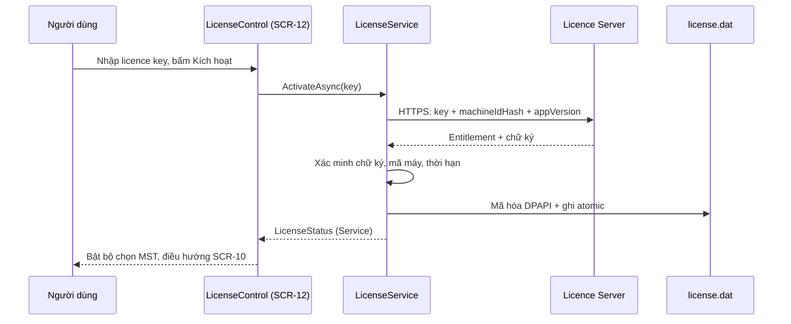

# DD-03 — Licence, entitlement và phân quyền tính năng

## 1. Thông tin tài liệu

| Thuộc tính | Giá trị |
|---|---|
| Mã tài liệu | DD-HDDT-03 |
| Tên | Kích hoạt licence theo máy, entitlement cục bộ, ReadOnlyServiceMode, SCR-12 |
| Phiên bản | 1.0 (mở rộng từ DD-HDDT-APP-SHELL-LOGIN-001 v1.0, mục 18) |
| Ngày | 01/11/2026 |
| Trạng thái | Thiết kế đã phê duyệt — chờ review tài liệu; giao thức licence còn chờ gate G-06 |
| Feature | [FT-04](../requirements/FEATURE-LIST.md#ft-04--licence-và-quyền-tính-năng) |
| SRS | BR-001, BR-016, BR-022, BR-024..025, FR-LIC-001..012, NFR-SEC-007..008, NFR-MNT-006, AC-12, AC-13, AC-16 |
| Màn hình | SCR-12 (Bản quyền); mục `Bản quyền` trong SCR-09 |
| Wireframe | [SCR-12](../wireframes/index.html?screen=SCR-12) · [PNG](../wireframes/png/SCR-12-license.png) |
| Phụ thuộc | [DD-00](DD-00-TECHNICAL-GATES.md) (G-06), [DD-01](DD-01-APP-SHELL-LOGIN.md) (startup, shell) |
| Phase triển khai | [Phase 2](../plans/PROJECT-PLAN.md#phase-2--khung-chương-trình-doanh-nghiệp-licence-và-đăng-nhập) |

## 2. Mục đích và phạm vi

### 2.1 Mục đích

Cung cấp cơ chế mở khóa ServiceMode bằng licence theo máy và kiểm tra quyền tính năng thống nhất ở cả UI lẫn application service.

### 2.2 Trong phạm vi

- `ILicenseService`, `IEntitlementService`, `LicenseService`, `LicenseApiClient`, `LicenseSignatureVerifier`, `MachineIdentityProvider`.
- Kích hoạt, xác thực lại, hủy kích hoạt trực tuyến; xác thực cục bộ mỗi lần khởi động.
- Lưu `license.dat` (DPAPI + chữ ký), thời gian ngoại tuyến 30 ngày, phát hiện lệch đồng hồ.
- Chuyển trạng thái `Standard` / `Service` / `ReadOnlyService`.
- SCR-12 và mục `Bản quyền` trong SCR-09.

### 2.3 Ngoài phạm vi

- Máy chủ licence production và giao diện quản trị licence (nhà cung cấp triển khai riêng; ở đây chỉ định nghĩa contract).
- Giới hạn số MST (BR-016: không giới hạn).

## 3. Mô hình và interface

### 3.1 Entitlement

```csharp
public enum LicenseState { None, Active, Expired, Revoked, OfflineGraceExceeded, Invalid }

public sealed class Entitlement
{
    public string LicenseType { get; private set; }
    public string MachineIdHash { get; private set; }
    public DateTime IssuedAtUtc { get; private set; }
    public DateTime? ExpiresAtUtc { get; private set; }
    public DateTime LastOnlineValidationUtc { get; private set; }
    public ISet<AppFeature> Features { get; private set; }
}

public enum AppFeature
{
    MultiCompany,     // SCR-10/11, bộ chọn MST, thêm/chuyển MST
    PortalLogin,      // đăng nhập cổng Thuế
    NewDownload,      // tải mới
    ReadExport,       // xem/in/xuất/sao lưu dữ liệu cũ
    ManageSettings    // sửa cấu hình nghiệp vụ quan trọng
}
```

### 3.2 Interface

```csharp
public interface ILicenseService
{
    Task<LicenseStatus> ValidateLocalAsync(CancellationToken ct);
    Task<LicenseStatus> ValidateOnlineAsync(CancellationToken ct);
    Task<LicenseStatus> ActivateAsync(string licenseKey, CancellationToken ct);
    Task<LicenseStatus> DeactivateAsync(CancellationToken ct);
}

public interface IEntitlementService
{
    AppMode CurrentMode { get; }
    bool IsAllowed(AppFeature feature);
    void Demand(AppFeature feature);   // ném EntitlementDeniedException
    event EventHandler ModeChanged;
}
```

Mọi application service thay đổi dữ liệu hoặc tải mới phải gọi `Demand` (FR-LIC-012). UI chỉ ẩn/khóa control dựa trên `IsAllowed`.

### 3.3 Ma trận tính năng theo chế độ

| Tính năng | Standard | Service | ReadOnlyService |
|---|:---:|:---:|:---:|
| MultiCompany (SCR-10/11, bộ chọn MST) | ✗ | ✓ | Chỉ chuyển giữa MST đã có |
| PortalLogin | ✓ | ✓ | ✗ |
| NewDownload | ✓ | ✓ | ✗ |
| ReadExport | ✓ | ✓ | ✓ |
| ManageSettings | ✓ | ✓ | ✗ |
| Nhập licence key (SCR-12) | ✓ | ✓ | ✓ |

## 4. Luồng chính

### 4.1 Kích hoạt (AC-13)



Request tuyệt đối không chứa MST, số lượng khách hàng, đường dẫn kho hoặc dữ liệu hóa đơn (BR-025).

### 4.2 Xác thực khi khởi động và định kỳ

1. Đọc `license.dat` → giải mã DPAPI → xác minh chữ ký → kiểm tra machine binding, hạn dùng, lệch đồng hồ.
2. Có Internet: `ValidateOnlineAsync`; thành công cập nhật `LastOnlineValidationUtc`.
3. Server lỗi/timeout/5xx **không** đồng nghĩa thu hồi: dùng thời gian ngoại tuyến còn lại, tối đa 30 ngày (FR-LIC-005, mục 11.4 SRS).
4. Hết hạn, thu hồi hoặc quá 30 ngày → `ReadOnlyService` (FR-LIC-007).
5. Đồng hồ hệ thống lùi/nhảy bất thường → yêu cầu xác thực trực tuyến trước thao tác cần ServiceMode (FR-LIC-011).

### 4.3 Hủy kích hoạt

`DeactivateAsync` gọi server giải phóng máy; xóa `license.dat`; chuyển Standard (hoặc ReadOnlyService nếu từng có nhiều kho). Mất máy: nhà cung cấp reset phía server (FR-LIC-009).

## 5. Chính sách entitlement cục bộ

### 5.1 Local entitlement

- `license.dat` được DPAPI `LocalMachine` bảo vệ.
- File vẫn phải có chữ ký bất đối xứng của server.
- Public key xác minh được nhúng trong application.
- DPAPI không thay thế chữ ký.
- Thư mục áp dụng ACL phù hợp.
- Thời gian sử dụng ngoại tuyến tối đa là 30 ngày kể từ lần xác thực trực tuyến thành công gần nhất.

### 5.2 Dữ liệu gửi server

Chỉ gửi:

- Licence key.
- Mã máy đã băm.
- Phiên bản ứng dụng.

Không gửi:

- MST.
- Số lượng/danh sách khách hàng.
- Token Thuế.
- Hóa đơn.
- Đường dẫn kho.

### 5.3 ReadOnlyServiceMode

Được phép:

- Mở các MST đã có.
- Xem, tìm, in, xuất và sao lưu dữ liệu cũ.

Không được phép:

- Thêm MST.
- Đăng nhập cổng Thuế.
- Tải mới.
- Sửa cấu hình nghiệp vụ quan trọng.

Kiểm soát ở cả UI và application service.

## 6. Màn hình SCR-12 `LicenseControl`

- Hiển thị: loại licence, trạng thái, ngày hết hạn (nếu có), lần xác thực cuối, ngày phải kết nối lại, mã máy rút gọn.
- Hành động: `Kích hoạt` (ô nhập key), `Xác thực ngay`, `Hủy kích hoạt` (có xác nhận).
- Lỗi theo SRS mục 13: licence gắn máy khác (hướng dẫn hủy kích hoạt máy cũ/reset), server tạm lỗi (hiển thị lần xác thực cuối), hết hạn/thu hồi (chuyển chỉ đọc).
- Licence key đầy đủ không bao giờ ghi log; chỉ hiển thị 4 ký tự cuối.
- Standard: chỉ thông tin ứng dụng + ô nhập key (FR-LIC-001, NFR-USE-006).

## 7. Bảo mật

- Public key nhúng trong ứng dụng; chữ ký bất đối xứng; DPAPI không thay thế chữ ký (NFR-SEC-007).
- HTTPS, TLS 1.2, kiểm tra chứng thư; pin chứng thư theo chính sách phát hành đã duyệt.
- Handler HTTP của licence tách biệt handler của cổng Thuế.
- Log không chứa licence key đầy đủ, MST hay mã máy chưa băm (NFR-SEC-008).

## 8. Kiểm thử

### 8.1 Unit

- Chuyển trạng thái Standard → Service → ReadOnlyService → Service.
- Chữ ký sai, mã máy khác, hết hạn, thu hồi, quá 30 ngày ngoại tuyến.
- Lệch đồng hồ lùi/nhảy → yêu cầu xác thực trực tuyến.
- `Demand` từ chối `MultiCompany` ở Standard, `NewDownload`/`PortalLogin` ở ReadOnly khi gọi ngoài UI (AC-12, AC-16).

### 8.2 Integration

- Kích hoạt/xác thực/hủy kích hoạt với server giả lập; timeout, 5xx, mất mạng.
- DPAPI roundtrip `license.dat`; file hỏng không đưa app về Standard làm mất truy cập kho.
- Request thực tế không chứa MST/đường dẫn (kiểm tra payload).

### 8.3 UI smoke

- Kích hoạt hiện menu doanh nghiệp mà không cài lại (AC-13).
- ReadOnly có nhãn `Chỉ đọc – cần gia hạn licence`, không có hành động tải.

## 9. Theo dõi tiến độ implement

Trạng thái: ⬜ Chưa bắt đầu · 🟡 Đang làm · ✅ Hoàn thành · ⛔ Bị chặn.

### 9.1 Công việc

| ID | Công việc | Lớp | Phụ thuộc | Trạng thái | PR/Commit | Ghi chú |
|---|---|---|---|---|---|---|
| T03-01 | Domain: `Entitlement`, `LicenseState`, `AppFeature`, `AppMode` rules | Domain | T01-02 | ✅ | | `FeatureMatrix` (Domain), `LicenseGrant`/`StoredLicense`/`LicenseInfo`/`LicenseIssue` (Application); `LicenseEvaluator` thuần logic |
| T03-02 | `IEntitlementService` + `EntitlementService`, `Demand` trong service nghiệp vụ | Application | T03-01 | ✅ | | `EntitlementService.ApplyLicense` + `ModeChanged`; `Demand` đã dùng ở các service |
| T03-03 | `DevelopmentLicenseService` (Debug) | Infra | T03-02 | ✅ | | `DevelopmentLicenseService`/`DevelopmentEntitlementService` (Debug) theo interface mới |
| T03-04 | `MachineIdentityProvider`, `LicenseSignatureVerifier`, lưu `license.dat` (DPAPI) | Infra | T01-11, G-06 | 🟡 | | `FileLicenseStore` (DPAPI + atomic + .bak), `MachineIdentityProvider`, `RsaLicenseSignatureVerifier` (RSA-SHA256 tạm); **chờ G-06** để chốt thuật toán/khóa |
| T03-05 | `LicenseService` + `LicenseApiClient` (activate/validate/deactivate, offline grace, clock check) | Infra | T03-04 | 🟡 | | `LicenseService` (activate/validate/deactivate, ngoại tuyến 30 ngày, lệch đồng hồ) qua `ILicenseServer`; chưa có `LicenseApiClient` HTTP (chờ contract G-06) |
| T03-06 | `LicenseControl` + presenter (SCR-12), mục Bản quyền trong SCR-09 | WinForms | T03-02 | ✅ | | SCR-12 `LicenseControl`/`LicensePresenter`/`LicenseScreen`, lỗi licence map sang thông báo người dùng; shell cập nhật menu khi `ModeChanged`. **Chưa có** mục Bản quyền trong SCR-09 (SCR-09 chưa tồn tại) |
| T03-07 | Unit + integration test (mục 8.1–8.2) với server giả lập | Tests | T03-05 | 🟡 | | 39 test Application + 12 Infrastructure + 14 presenter SCR-12 với server giả; chưa có HTTP/timeout/5xx thật |
| T03-08 | UI smoke test (mục 8.3) | Tests | T03-06 | ✅ | | 3 UI smoke test: Standard hiển thị trạng thái, kích hoạt mở menu doanh nghiệp không cần cài lại (AC-13), ReadOnly khóa tải |

### 9.2 Nhật ký tiến độ

| Ngày | Nội dung | Người thực hiện |
|---|---|---|
| 01/11/2026 | Mở rộng từ DD-01 v1.0 mục 18; chưa có code | Claude Code |

## 10. Lịch sử thay đổi tài liệu

| Phiên bản | Ngày | Thay đổi |
|---|---|---|
| 1.0 | 01/11/2026 | Tách và mở rộng từ DD-01 v1.0 (mục 18): mô hình entitlement, luồng, SCR-12, test, theo dõi tiến độ |
